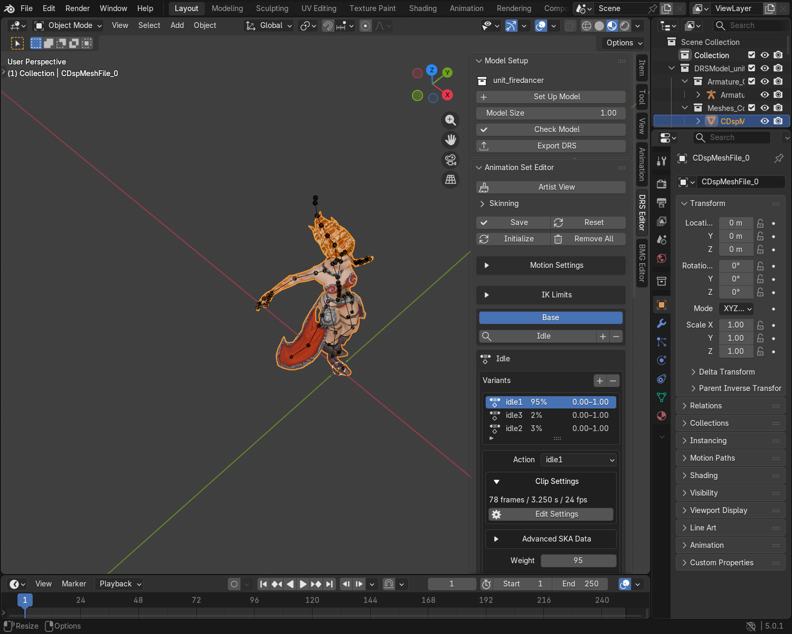
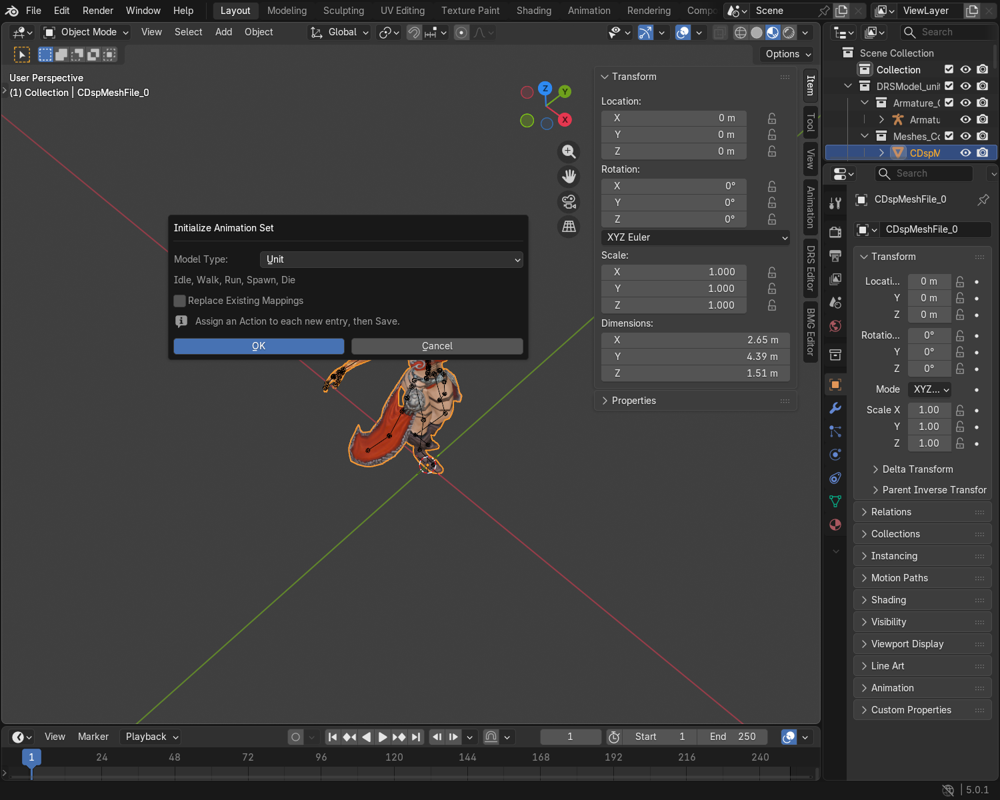
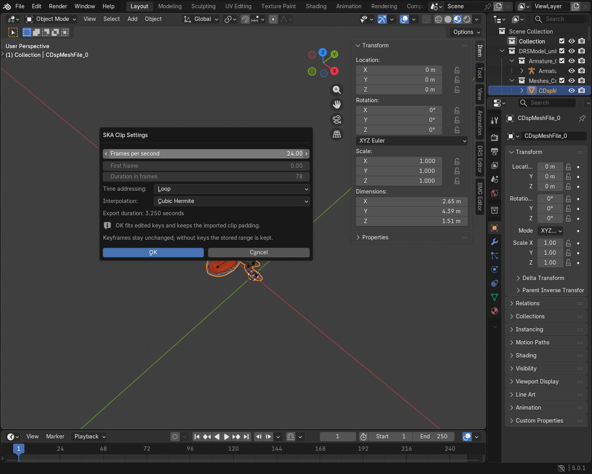
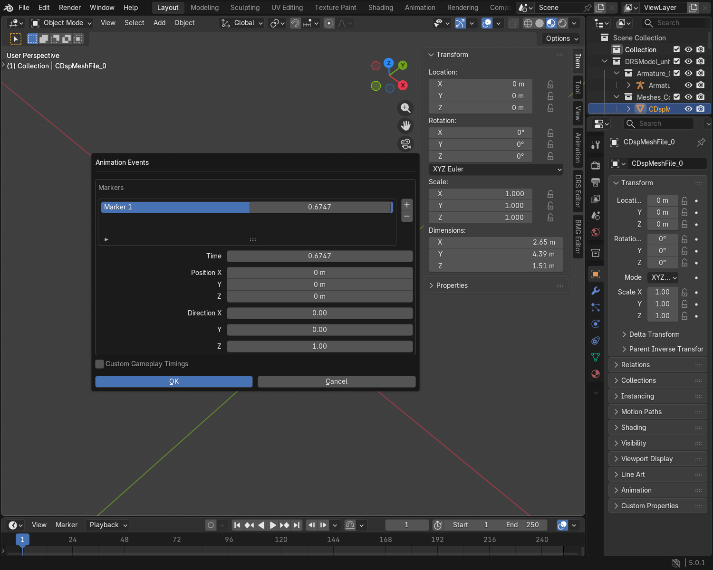

# Animation Set Guide

Assign your model's Actions to the animations used by the game. Finish your mesh,
materials and rig first. For animated props, see the [Object Guide](object_creation_guide.md).

For worked casts, multiple hit moments and channelled abilities, use the
[Advanced Animation Tutorial](animation_advanced_tutorial.md).

## 1. Assign animations

1. Select your model and open **DRS Editor → Animation Set Editor**.
2. For a new model, click **Init** or **Initialize Animation Set** and choose its type.
3. Select an entry and assign its **Animation (SKA)**.
4. Check it with **Play**.
5. Click **Save**. Save the `.blend` separately.

Switching between models keeps each model's pending animation edits and
selected entry for this Blender session. Click **Save** on each edited model
before exporting or saving your `.blend`. **Reset** reloads that model's saved
settings; opening a `.blend` starts from saved settings too.

In a narrow sidebar, click the current animation name beside the search icon
and type to choose another mapping. **+** opens Add Ability; **−** removes the
selected mapping. Widen the sidebar for the full mapping list.

| Model type | Starting entries |
|---|---|
| Static Object | None |
| Animated Object | Idle |
| Unit | Idle, Walk, Run, Spawn, Die |
| Building | Idle when there is an armature |

Use **Add Ability** for animations already used by the unit's game setup. This
assigns animations; it does not create a new gameplay ability.

For a new ability:

1. Click **+ → Ability (Cast / Resolve)** for a cast and recovery, or
   **Ability (Start / Loop / End)** for a sustained action.
2. Select the new **Ability** entry and give it a name, such as *Summon*.
3. Assign its Actions and set the phase boundaries. Press **Play** to check them.
4. Note the **Game animation tag** shown in the entry. The game ability must
   use this tag and the matching Cast/Resolve or Start/Loop/End gameplay jobs.
5. Click **Save**. Add another entry for another ability, then save your `.blend`.

The editor chooses an available existing animation slot. The DRS export does
not change the game's ability definition or create an ability. The game stores
IDs rather than the custom name, so reimporting a DRS does not restore the name.
If no compatible slot is available, the option is disabled. Test the ability
with its game setup before use.

??? info "Choosing a basic animation"
    The picker offers Idle, Walk, Run, Spawn, Death, Attack, directional Hit,
    Knockdown / Get Up and Cheer / Emote, plus Cast and the two ability layouts.
    Existing model type restrictions still apply.

??? info "Transitions between animations"
    The game normally blends from one animation into the next using its own
    crossfade settings. On the ordinary Cast / Resolve path, a custom ability
    uses the general Cast and Resolve transition rules even when its animation
    slot has a specific game name. You do not need to add a crossfade animation.

    The game's ability must still use the displayed tag and compatible jobs.
    Different mappings can use different playback types, so check the ability
    and its transitions in the Map Editor or game. Blender's Play controls do
    not reproduce the full game transition system.

Existing game-specific mappings are available in **Debug View**. Use those
when matching a unit's existing game setup. Blender playback does not simulate
the game ability; test the exported animation with its matching game setup.

An imported entry shown as **Animation … (unidentified)** is kept on export.
Keep it unless you know it is not needed by the model's game setup.

For **TombOfDeath**, the Start, Loop and End slots are available, but automatic
gameplay timing is not verified. Check the timings with the game's setup.

Choose the **Mode** used by the unit's game setup. Base, Mode 1 and Mode 2
are separate animation banks. Mode 1 and Mode 2 do not mean entering and
leaving a mode.

> **Keep a working Base Idle for units.** Several missing animations fall back
> to it. Loading the model does not prove every action can play safely.

For alternative animations, assign each variant an Action and weights such as
**80 / 20**, totaling **100%**. These are percentage chances. Use **Normalize
to 100%** when shown to calculate them while keeping the proportions.
Check every variant. Unassigned variants are not exported.

## 2. Check the clip

Open **Clip Settings → Edit Settings** to change FPS, looping and interpolation.
For a keyed Action, edit its keys to change the length, then confirm with **OK**.
The range is calculated from those keys; imported end padding is kept. Without
keys, the stored range is editable. Settings belong to the Action and are shared
by entries using it.

Changing FPS changes duration without moving keys. It does not change Blender's
rendering performance. **Play** sets the scene's clip range and frame rate.

Keep **Allows IK** enabled when the game should use procedural IK during this
clip. Use **Force No Blend** only when normal pose blending is unwanted.

## 3. Set the release moment

For one Action containing both preparation and recovery:

1. Add the matching cast entry and choose **One Clip**.
2. Assign one Action containing the whole motion.
3. Set **Cast→Resolve** to the release moment.
4. Check **Play Cast** and **Play Resolve**, then **Save**.

**Cast** is preparation before releasing the spell or shot. **Resolve** is the
recovery afterward: draw the bow, release the arrow, then lower the bow.

For a 1.2-second Action releasing at 0.3 seconds, use **0.25**. Cast lasts
0.3 seconds; recovery lasts 0.9 seconds. You do not need two SKA files.

Spawn and Idle do not need an artificial Cast/Resolve pair. Keep the entries
used by the existing gameplay ability.

A Spawn Action can contain several visual stages, such as appearing, rising
and landing. Keep them in one clip. Adding Spawn variants creates alternatives,
not a sequence of stages.

For a channelled ability, Start / Loop / End let the middle section repeat
until gameplay ends the ability. Use the phases required by that ability;
splitting an Action alone does not add gameplay phases.

### Separate clips

Choose **Separate Clips** to assign a different Action to each phase. Assign
**Cast** and **Resolve**, check each with **Play**, then **Save**. Each phase
uses its whole clip; change **Range Start / End** only to trim it.
For independent clips, trimming the Actions themselves is safest: disjoint
ranges can change the engine's phase timing order.

For example, a 0.4-second Cast and 0.8-second Resolve release at 0.4 seconds
and finish at 1.2 seconds. Timing is calculated automatically. Start / Loop /
End sets offer the same clip choice. Keep corresponding variant counts and
weights aligned; editing a phase's variant weight updates the matching phases.

Switching clip layout resets phase ranges. Imported separate clips stay separate.
For Ground & Air casts, keep their release and total durations matching.

## 4. Place a spawn or attack marker

1. Select the variant and click **Edit Markers**.
2. Choose a marker and set **Time**: `0.5` means halfway through the whole Action.
3. Use **+ / −** to add or remove markers. Confirm with **OK**.
4. Click **Display Marker** to inspect the selected marker's pose.
5. Move or rotate the helper in Object Mode, then click **Save Placement**.
6. Click **Save** for the animation set.

> **Direction can affect gameplay.** A melee marker can steer pushback as well
> as visual hit reactions. Keep imported directions unless you want to change
> the attack's response.

For ordinary attacker-to-target pushback, set **Direction** to **0, 0, 0**.
The helper becomes a sphere because it has no direction. New markers use this
neutral setting.

Moving the helper edits its stored Position. The verified timing-generation
path does not use that position as the impact location. Use a **locator** for
a projectile or attached effect: see the [Locator Guide](advanced_locators_guide.md).

All markers are editable. For an attack with several hit moments, add one marker
per moment. Their gameplay timings are generated when saving. The unit's gameplay
ability must also support those events; extra markers alone do not create new
attacks or effects. Removing all markers leaves an empty list.

??? info "Timing readout"
    **Cast (ms)** is the event offset. **Duration (ms)** includes the whole
    animation. For 300 / 1200 ms, recovery is 900 ms.

    Markers and EffectSet events are separate. To align them, use the same
    Action and time fraction. A marker does not create an effect by itself.

    New or edited markers generate gameplay timings from the marker time and
    clip duration when you save. Unchanged imported timings are preserved.
    After changing only a clip's length or FPS, check the timing readout: an
    existing marker's timing may not be rebuilt automatically. If necessary,
    edit the marker and save the animation set again. Custom timing overrides
    remain fixed until you change or disable them.

    SKA text events such as `<blink>` are a separate feature under the selected
    animation's **Advanced SKA Data**. They are not these gameplay markers or
    Effect Set events. Their use in Skylords still needs practical testing.

??? tip "Advanced: custom gameplay timing"
    Click **Edit Markers** (or **Edit Events** where shown) and enable **Custom Gameplay Timings** to add, remove
    or edit timing records directly. **Event (ms)** is the trigger moment;
    **Total (ms)** includes recovery. Keep the event within that total.

    These overrides stay fixed when clip lengths change. Disable the option
    to return to timings generated from markers or phases. Verify custom timing
    in the Map Editor with the matching gameplay ability.

## 5. Adjust motion settings when needed

Keep imported settings unless you intend to change the model's response in-game.
In a narrow sidebar, open **Motion Settings** to edit these controls.

| Setting | Use |
|---|---|
| Walk / Run Reference Speed | Match the speed each movement clip was authored for; this does not set gameplay speed. |
| Partial Mode Change | Keep the established setting for units with mode transitions. |
| Align to Terrain | Let a ground unit tilt with the terrain. |
| Flight → Hovering Ground Unit | Configure hovering motion and its matching pushback response; this does not grant flight. |
| Turn Banking / Movement Pitch / Hit Displacement | Adjust a flying or hovering unit's visual motion response. |

You do not need to enter Timing Attribute IDs. Changing **Hovering Ground Unit**
also updates its matching runtime attribute. Other imported attributes are retained.

## 6. Edit IK limits when needed

Open **IK Limits** and select a bone on the deform armature in **Pose Mode**.

1. Click **Add IK Limits**, or **Edit Angle Limits** for an imported entry.
2. Choose **Look At**, **Curve Walking**, or both for the intended engine IK use.
3. Keep imported axes, **Inverted** and **Chain Order** settings unless you
   are deliberately rebuilding the IK chain.
4. Edit the enabled X/Y/Z angle limits. Open **Advanced IK Settings** for
   chain order, inversion and damping.
5. Export the model. Bone IK settings are read directly during export.

**Remove IK Limits** removes that bone's exported IK entry.

The game supplies procedural targets and movement state. Regular Blender
playback does not reproduce the complete engine IK controller. The generated
limit constraint is muted so it does not constrain every keyframed pose.
For motion that must play exactly in Blender and the SKA, bake it onto deform bones.
The [Advanced IK Tutorial](ik_advanced_tutorial.md) covers both workflows.

## 7. Export and check

1. Click **Save** in the Animation Set Editor and save the `.blend`.
2. Bake control-rig or constraint-driven motion onto the deform rig when needed.
3. Export the DRS and its intended SKA Actions together.
4. Check Idle, movement, release timing and pushback in the Map Editor.

??? info "Imported root alignment and metadata"
    Keep the imported rig's rest pose and root alignment. The plugin preserves
    its additional root transform, called **SuperParent**. Do not add an extra
    bone with that name. After changing the rest pose, export matching DRS and
    animation files together.

    You do not need to create metadata hashes or UUIDs. Keep imported metadata;
    the exporter supplies the structure for new models.

For sound and visual effects, continue with the [Effect Set Guide](advanced_effects_guide.md).
