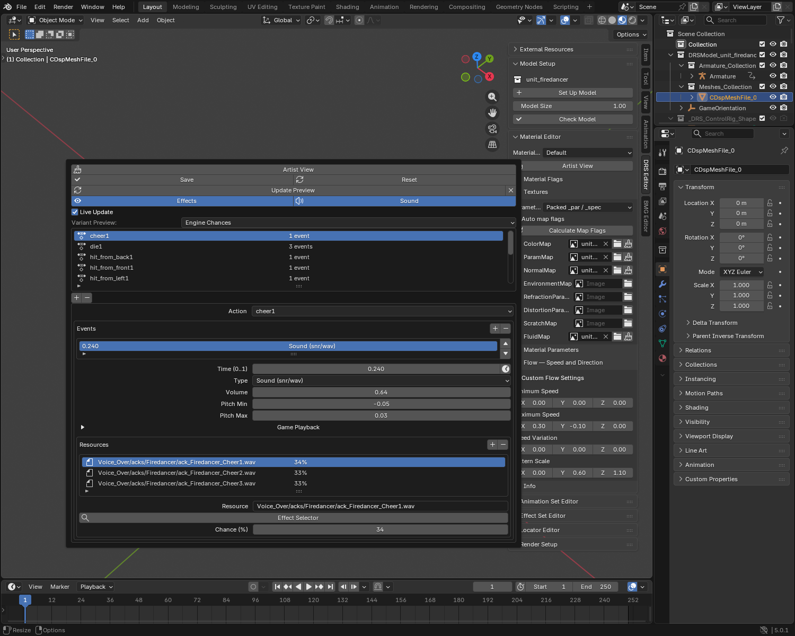
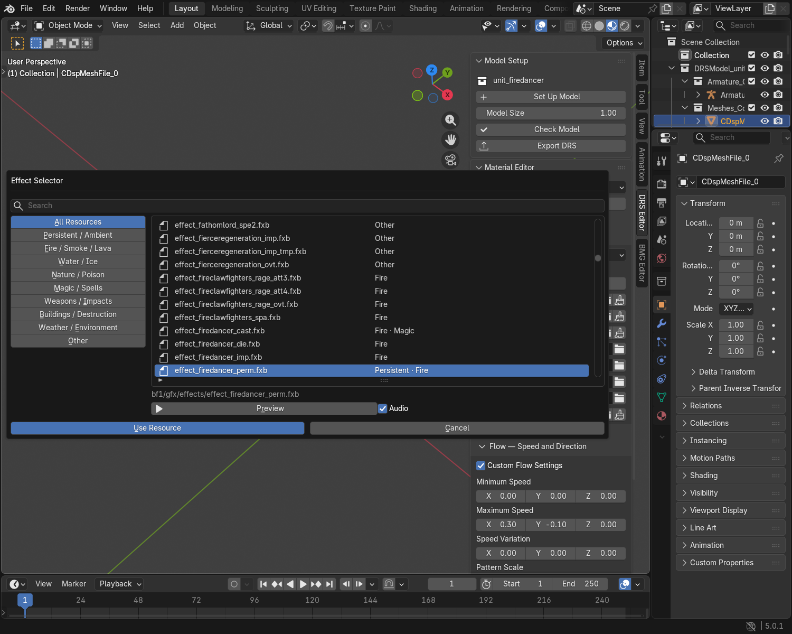

# Effect Set Guide

Add existing sounds and visual effects to a model's animations. Create or edit
the effects themselves in the external Effect Editor.

For timed sound/FX layers, fading attached effects and controller previews,
follow the [Advanced Effects Tutorial](effects_advanced_tutorial.md).

For continuous fire or smoke, use a [persistent locator](advanced_locators_guide.md#choose-and-preview-an-effect).
For building destruction, use [Damage Preview](building_creation_guide.md#preview-damage-and-destruction).

## 1. Set the library folder

Open **Edit → Preferences → Add-ons → SR ImpEx**.

- Set **Skylords Reborn Folder** to your game installation, containing `base/pak`.
- Leave **Effects Folder** empty for installed game assets. Set it to a loose
  asset folder when testing your own effects.

The paths are saved automatically. The first search builds an index; later
searches reuse it. Use **Refresh Effect Library** if an asset is missing after
you add or replace files.

Switching models keeps pending event edits and the selected event/resource
for this Blender session. Click **Save** for each edited model before exporting
or saving the `.blend`. **Reset** reloads that model's saved EffectSet.

## 2. Add an event

1. Select your model and open **DRS Editor → Effect Set Editor**.
2. Add an entry and choose its **Action**.
3. Under **Events**, click **+** and choose its **Type** from the table below.
4. Set **Time**: `0` is the clip's start, `0.5` its middle and `1` its end.
5. Under **Resources**, choose a resource alternative and open **Effect Selector**.
6. Search for a resource, select it and click **Use Resource**.
7. Use one variant at **Chance 100%** while testing.
8. Click **Save**, then save your `.blend`.

A new animation entry uses the Action currently assigned to the model's armature.
Use the clock button beside **Time** to copy the playhead's position within
that Action. Play the same Action on the model first.

| Type | Use it to |
|---|---|
| Sound | Play a sound. |
| World FX | Spawn an effect at the model's position, with an offset. |
| Linked FX | Play an effect using its own source/target attachment setup. |
| Fade Out Persistent FX | Fade out an existing locator effect with that resource name. |
| Fade In Persistent FX | Fade that persistent effect back in. |

For fades, set **Fade Duration (s)**. These events affect an existing effect;
they do not spawn a new one. For other FX events, **Offset** adjusts placement.
Use a locator when an effect needs a particular bone attachment.

## 3. Choose a resource

In **Effect Selector**, search at the top or choose a category on the left.
Use **All Resources** if you cannot find a name. Sound events show audio resources.

**Preview** auditions the selected resource. **Use Resource** assigns it to the
editable filename field; **Cancel** keeps the previous resource. Save the
EffectSet or apply the locator changes afterward.

## 4. Play and adjust

1. In **Object Mode**, click **Update Preview**.
2. Press **Space** to play the normal timeline.
3. Adjust timing, resource, volume, pitch or offset. **Live Update** applies
   changes after a short pause in editing.
4. Click **Save** when you are happy with the result.

Use **Effects** to switch the whole model's FX preview on or off. Off also mutes
its sounds; the model animation continues. Use **Sound** to mute just the preview
audio. These switches also apply to locator FX, take effect immediately and do
not change exports. Switching on reuses the cached preview at the current frame.

**Selected Variant** auditions the highlighted resource; **Engine Chances** uses
the saved chances. **×** beside Update Preview removes the generated preview
instead of hiding it. Rebuild after reopening a `.blend`.

??? tip "An imported effect has no loaded Action"
    Some models retain effect entries for clips that their Animation Set does not
    use. The list still shows the stored filename; the events are preserved.
    For example, Vulcan retains `run_flamethrower1` and `spawn_shadowflame_demon1`.
    To inspect extra clips, import the DRS with **Other Clips in Folder** enabled.
    You do not need to assign a different animation just to remove the notice.

For an event that must line up with an attack, use the same Action and time
fraction as its animation marker. A marker does not create an effect by itself.

### Variants and chances

Variants are alternatives. Use **80 / 20** for two choices, or **40 / 30 / 30**
for three. These total **100%**, so one resource is always chosen.

**4 / 3 / 3** leaves **90% silence or no effect**. Click **Normalize to 100%**
to keep those proportions but play a resource every time. Avoid totals above 100%.

To play two resources together, add **two events at the same Time**, each with
its own resource variant.

## 5. Export and test

1. Save EffectSet and AnimationSet changes, then save your `.blend`.
2. Export with **Include Animation Files** to include referenced animation clips.
3. Install custom effects, textures and sounds separately alongside their dependencies.
4. Reimport a copy of the model, then test the result in the Map Editor.

??? tip "Advanced: sound controls"
    **Volume** adjusts the cue. **Pitch Min / Max** vary its playback rate:
    `0` is unchanged, `0.1` is 10% faster, and `-0.1` is 10% slower. Duration changes too.

    Fields marked **Export Only** are saved for the game. Spatial falloff needs
    positional audio; interruptible cues need gameplay interruptions. Check
    those behaviours in the Map Editor or game. Open **Game Playback** to edit
    falloff and interruption settings. The preserved Condition is only shown in Debug View.

    To create overlapping sound layers, use separate events. Variants choose
    alternatives; they do not mix several sounds together.

??? info "Advanced: preview limits"
    Blender previews particles, effect meshes, lights, trails, decals, effect
    animation controllers and cached debris. Some appearances and gameplay
    responses still differ from the game.

    | Feature | How to check it |
    |---|---|
    | Refraction meshes | Update Preview, add a render setup with **Add Render**, then press **F12**. The viewport uses simpler shading. Check overlapping haze in the Map Editor. |
    | Glow | Added automatically for supported effects. Compare its final brightness in the Map Editor. |
    | Billboard masks | Loaded automatically with the effect. Their alpha controls visibility; the mask stays in place while the color texture animates. |
    | Terrain contacts | Add a terrain mesh outside the model's export collection, then rebuild the preview. Without one, the preview uses flat ground. |
    | Debris and particle motion | Rebuild after changing the model animation or environment. Playback reuses cached motion. |
    | Dense effects | Preview counts and sampling can be reduced. Read **Effect Preview Report** for this resource. |
    | Heat haze, scene fog, water waves and advanced links | Parts remain incomplete. Use the Map Editor for the final check. |
    | Camera shake | Reported without moving your camera. |

    Read the model's **Effect Preview Report** in Blender's Text Editor for
    missing dependencies and unsupported components. Do not edit generated
    preview objects; edit the reference or the original effect and rebuild.

??? info "Troubleshooting"
    | Problem | Check |
    |---|---|
    | No previewable resources | Check the selected Action, resource paths and Audio toggle. A clip without events, or a chance of silence, can be valid. |
    | Resource not found | Check folders, filename and dependencies. Some sounds use an XML sound set or an SNR/SNS pair. |
    | Ambiguous resource name | Use a unique resource name or remove duplicate test assets from your library. |
    | Effect appears at the wrong pose | Time is a fraction of the whole clip, not seconds or a frame number. |
    | One animation variant has no effect | Add an entry for each SKA clip that needs it. |
    | Fade has no effect | Check that a persistent locator uses the matching resource name. |
    | Effects lag behind your edits | Wait for a rebuild to finish. Large effects take longer. Updates wait until rendering ends. |
    | An effect needs its own animated rig | Keep its referenced DRS and SKA in the library. Update Preview loads the supported controller automatically. |

Continue with the [Animation Set Guide](advanced_abilities_guide.md) for action
mappings, or the [Locator Guide](advanced_locators_guide.md) for attachment points.
