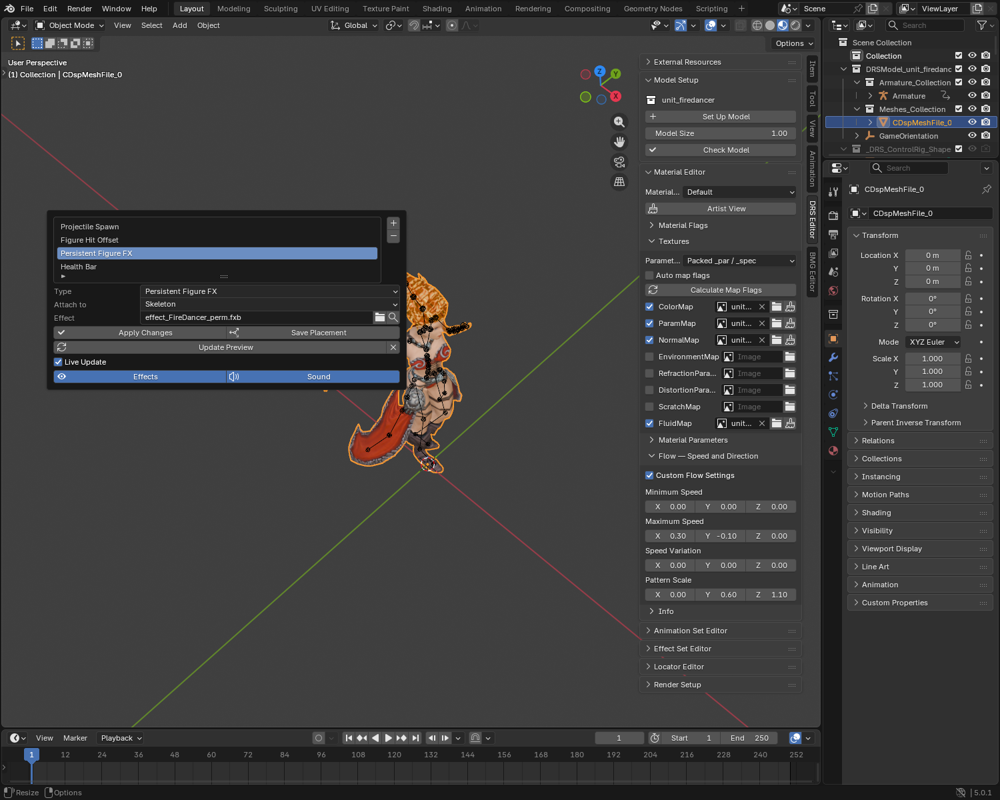
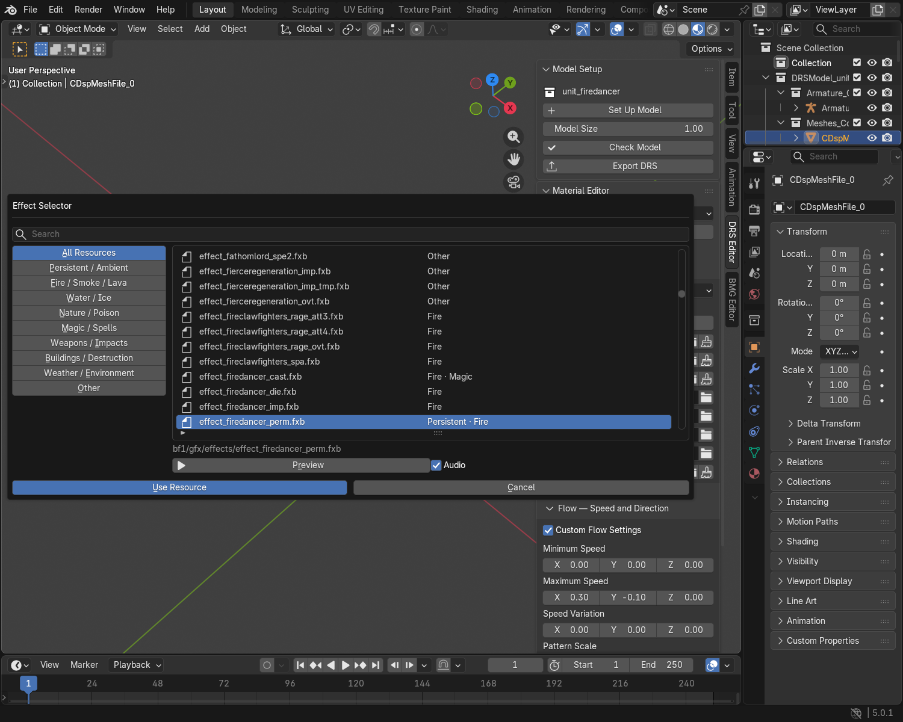

# Locator Editor

Locators are attachment points for effects, projectiles, health bars and model parts.

Use a locator for **where** an effect or projectile is attached. Use an
animation marker for **when** a supported gameplay event occurs; adding a
locator alone does not create that event. See the
[Animation Set Guide](advanced_abilities_guide.md#4-place-a-spawn-or-attack-marker).

## Edit a locator

1. Select your model and open **DRS Editor → Locator Editor**.
2. Select a locator in the list, or click **+** beside the list and choose its type.
3. Choose **Attach to**. For a resource locator, select its **Effect** or **Resource**.
4. Click **Apply Changes**.
5. Move or rotate the marker in the viewport, then click **Save Placement**.
6. Save your `.blend` and export the model.

The list stays short; scroll to see more entries. **−** beside the list removes the selected locator record and its marker. Only relevant fields appear below the list. Hover over **Attach to** for a description of each choice.

Changing an attachment starts the locator at its new attachment's origin. Changing only its type or filename keeps its placement. Apply pending detail edits before saving placement.

## Choose an attachment

| Choice | What it means |
| --- | --- |
| **Model** | Moves with the model, without following a particular bone. |
| **Skeleton** | Gives the effect access to the model's skeleton, so the effect can use its own bone links. |
| **Bone** | Follows the bone you choose. |

For imported models, keep the original attachment unless you intend to change it. **Skeleton** does not mean the first or root bone. Firedancer uses it for one persistent effect whose internal emitters attach to her head and hands.

??? info "Imported attachments"
    Older lists use the same editor. Export selects the record layout needed
    for your changes. The former numeric options **-1** and **-2** are now
    **Model** and **Skeleton**; keep the imported choice unless changing the attachment.

## Choose and preview an effect

1. Configure **Skylords Reborn Folder** in the add-on preferences. See the [Effects Guide](advanced_effects_guide.md).
2. Select a **Persistent Figure FX** or **Persistent Building FX** locator.
3. Click the search icon beside **Effect** to open **Effect Selector**. Search by name or choose a category.
4. **Preview** auditions the resource. **Use Resource** updates the draft filename; **Cancel** keeps the previous one.
5. Click **Apply Changes**, then **Update Preview**. Press **Space** to play the timeline.

**Effects** switches this model's cached FX preview on or off, including its sound.
The model animation continues. **Sound** mutes only the preview audio. Both
switches also control the same model's Effect Set previews and do not change exports.
**Live Update** refreshes resource edits after you pause editing. **×** beside
Update Preview removes the generated preview. State-triggered effects require
the corresponding game state; they are not automatically played as persistent effects.

Firedancer's Idle fire comes from her persistent locator, not an Idle EffectSet entry. It can play without an animation event.

Categories are filename hints. The source effect files remain external assets; assigning a reference does not copy them into the DRS. Create or edit effects in the external Effect Editor.

## Placement and export

- Use **+**, rather than duplicating marker objects. Duplicated markers can share the same internal identity.
- Use **Save Placement** after moving or rotating markers. Export uses saved locator data, not unsaved viewport movement.
- Deleting a marker alone does not remove its saved locator. Use **−** beside the list.
- Module references can show imported model parts. Changing a filename does not automatically rebuild construction geometry.
- Preserve imported unknown types. IDs 14 and 15 are not offered for new locators.
- Test attachments through representative animations and in the Map Editor after export.

## Common problems

| Problem | Check |
| --- | --- |
| No locator list | Select a mesh or collection belonging to the intended model. |
| A bone attachment cannot be selected | Import the model's skeleton first. |
| A marker moves to the origin | Changing attachment resets placement. Position it afterward and Save Placement. |
| A locator returns after deleting its marker | Remove the record with **−** beside the list. |
| Export uses an old position | Save Placement before exporting. |
| The effect is missing | Check the library path and resource filename, then Update Preview. Game-state FX may require their activation state. |

See the [Effects Guide](advanced_effects_guide.md) for animation-triggered effects and sounds, and the [Unit Guide](unit_creation_buide.md) for the full workflow.
