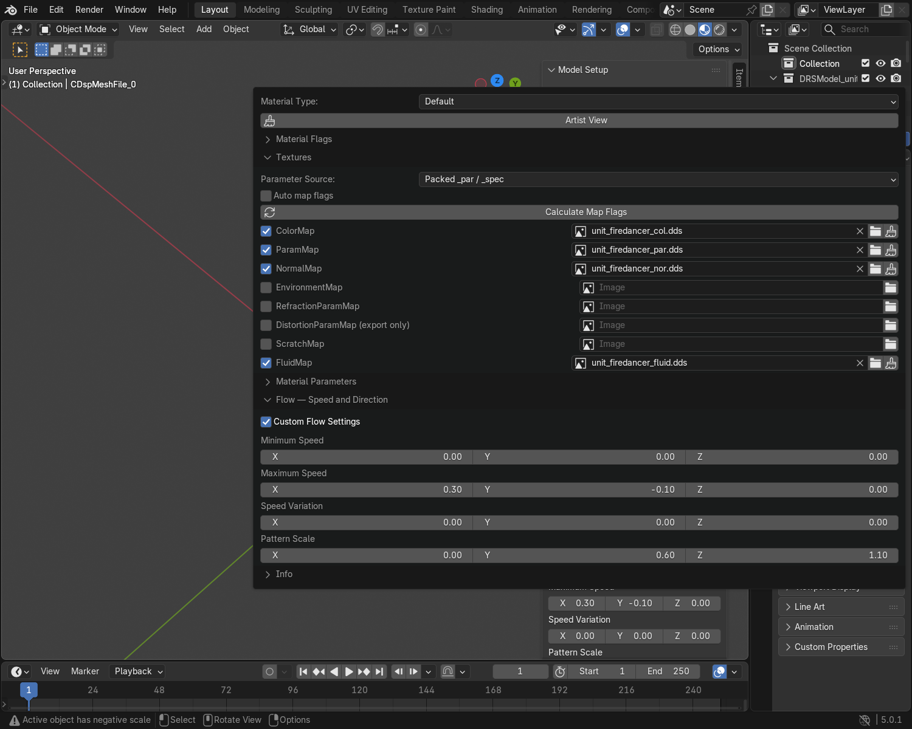

# Shading Recipes

For ordinary solid surfaces, start with the [Default Material Guide](material_artist_workflow.md).
These recipes cover cutouts, smooth transparency, flowing surfaces and reflections.

Select a mesh and open **DRS Editor → Material Editor**. Use **Artist View**.
Keep an imported model's material type unless you intend to change its appearance.

## Cut-out leaves, fences and fabric

1. Use **Default** and assign the ColorMap.
2. Put the cutout mask in **ColorMap alpha**: white is visible; black is a hole.
3. Enable **Material Flags → EnableAlphaTest**.
4. Inspect the edges, export a copy and check it in the Map Editor.

Alpha Test makes a visible-or-invisible cutout. Use the next recipe for a soft fade.
Default's **ParamMap alpha controls emissivity**, so do not put the cutout mask there.

## A simple surface with smooth transparency

1. Choose **SimpleTextured**.
2. Assign its Texture with an opacity gradient in the image alpha channel.
3. Start with white **Color**, material **Alpha 1** and **UseVertexColor** off.
4. Use white alpha for visible areas, black for invisible areas and gray for partial opacity.
5. Lower material **Alpha** to fade the whole surface further.

Keep alpha when saving the texture. If overlapping surfaces look wrong, try
**DisableDepthWrite** while keeping depth testing enabled, then test in the Map Editor.

Switching to SimpleTextured changes the material's features. It does not keep
Default's normal/PAR lighting or FluidMap flow. For a flowing waterfall, use
the recipe below first.

## Lava and other flowing surfaces

1. Keep **Default** and assign its **FluidMap**.
2. Assign the **ParamMap**; use its blue channel to mask where flow appears.
3. Open **Flow — Speed and Direction** and enable **Custom Flow Settings**.
4. Set **Minimum Speed** and **Maximum Speed**. Use matching values for steady movement.
5. Adjust **Pattern Scale**, then press **Space** to play.

The body can stay still. Flow uses the timeline and continues across clip loops.
Pause to hold it; scrub while paused to inspect a particular time.

Leaving Custom Flow Settings off uses the default movement. It does not disable flow.

??? tip "Flow while rendering"
    Render frames use timeline time. The same frame gives the same flow pattern.
    A continuously playing viewport can look different after several animation loops.

## Reflections

1. Enable **UseEnvironmentMap**.
2. Assign an **EnvironmentMap**, or choose **Use Bundled Environment** when shown.
3. Use **Render Setup → Add Render** and inspect the whole model in **Rendered** shading.

The game's lighting and environment can differ. Check the final reflection in
the intended map.

## Refraction and a soft-edged waterfall

For a waterfall that already flows, keep its **Default** material and FluidMap.

1. Assign **RefractionParamMap**.
2. Start with white **RefractionColor** and **RefractionScale 0**.
3. Use neutral RG and black B in the refraction map for the first test.
4. Increase its alpha near the soft edge to add the background there.
5. Reduce the water contribution in that same area. Fade the ParamMap blue flow
   mask and check that the ColorMap and glow do not leave a solid edge.
6. Disable Alpha Test for this soft-edge test.
7. Check the edge before adding subtle distortion with RefractionScale.

Refraction-map alpha adds background; it does not automatically hide the water.
Keep the rest of the material dark enough at the faded edge. Test the finished
waterfall in the Map Editor.

??? info "Advanced: refraction texture channels"
    For this Default refraction setup, **RG** controls the background distortion,
    **B** contributes blur/mip bias, and **alpha** contributes filtered background.

    The Blender camera preview reproduces part of this. The B-channel blur,
    overlapping layers and viewport appearance still differ from the game.
    For effects containing refraction meshes, **Update Preview → Add Render → F12**
    gives the more complete supported preview. See the
    [Effect Set Guide](advanced_effects_guide.md).

## Vertex-painted color

For a **Textured** or **SimpleTextured** material, use **Create SR Vertex Colors**.
Paint the resulting **SR Color0** attribute and keep the material's vertex-color
flag enabled. Check the exported result in the Map Editor before relying on it
for a new material setup.

??? info "Other material types and preview limits"
    The selector includes specialized effect, terrain and render-pass materials.
    Do not switch an ordinary model to one of these just to enable a single
    feature. Keep an imported material's type and edit its named slots.

    | Material family | Current Blender workflow |
    |---|---|
    | Default | Use the Default Material Guide for its maps, flow, wind and supported surface parameters. |
    | Textured / SimpleTextured | Edit their Texture, Color and supported flags. The Default PAR channel recipe does not apply. |
    | DiffuseSpecular variants | Use their DiffuseMap and SpecularMap. The preview covers basic color/specular inputs, with approximate lighting. |
    | Lava / Effect | Keep the source setup. Some base inputs are previewed; specialized procedural layers and shader behaviour are not fully reproduced. |
    | Billboard / ParticleSystem / StatefulParticles / Trail | For particle motion and effect-controlled animation, use the FX preview. A material on a static mesh does not create an emitter. |
    | Decal, cliff, terrain, sky and UI families | Basic routed textures may be visible; the game's projection, layering and scene passes are not recreated as a complete shader. |
    | Remaining specialized handlers | Preserve the imported setup. A readable/exportable parameter is not proof of a matching visual preview. |

    **Billboard:** its **Texture** alpha controls transparency. Enable
    **UseAlphaMask** to multiply it by **MaskTexture** alpha. Mask colors do not
    tint the result. On a mesh, these textures use its UVs; the FX preview
    supplies the effect's camera-facing quad and separate mask coordinates.

    **Default distortion:** assign a **DistortionParamMap** with gradients in
    its alpha channel. **DistortionMeshScale** moves the separate distortion
    surface along its normals. Blender approximates the distortion with
    refraction.

    **MonoColor** uses **Alpha** for opacity. In **VolumetricFog**, the red
    channel of **DensityMap** varies the density. **DensityMapInfluence**
    controls how much of that pattern is visible.

    **Export only** settings are saved and have no live preview. Default
    **DepthWriteThreshold** is in Debug View and affects depth writes during
    an engine fade. **Engine effect unverified** means the flag is registered
    and its visual effect in the engine has yet to be established.

    Complete recipes and visual comparisons for every specialized material are
    still outstanding. The supported basic preview is useful for editing; it
    is not a replacement for the final engine check.

## Before sharing

1. Save painted images and your `.blend`.
2. Export to a separate folder and review the log.
3. Reimport the exported model and inspect its maps and transparency.
4. Check the moving surface, reflections and edges in the Map Editor.

??? info "When the Blender preview differs"
    | Appearance | Next check |
    |---|---|
    | A slider has no effect | Its value may come from a texture. Edit that map instead. |
    | A map does nothing | Check the selected material type, slot checkbox and feature flag. |
    | Flow is static | Press Space; check FluidMap and the blue flow mask. |
    | Soft transparency has hard edges | Disable Alpha Test and use a material setup supporting smooth transparency. |
    | Refraction differs | Compare a camera render and the Map Editor; blur and layered distortion are incomplete in Blender. |
    | Reflections or glow look different | Compare the intended game lighting and environment. |
