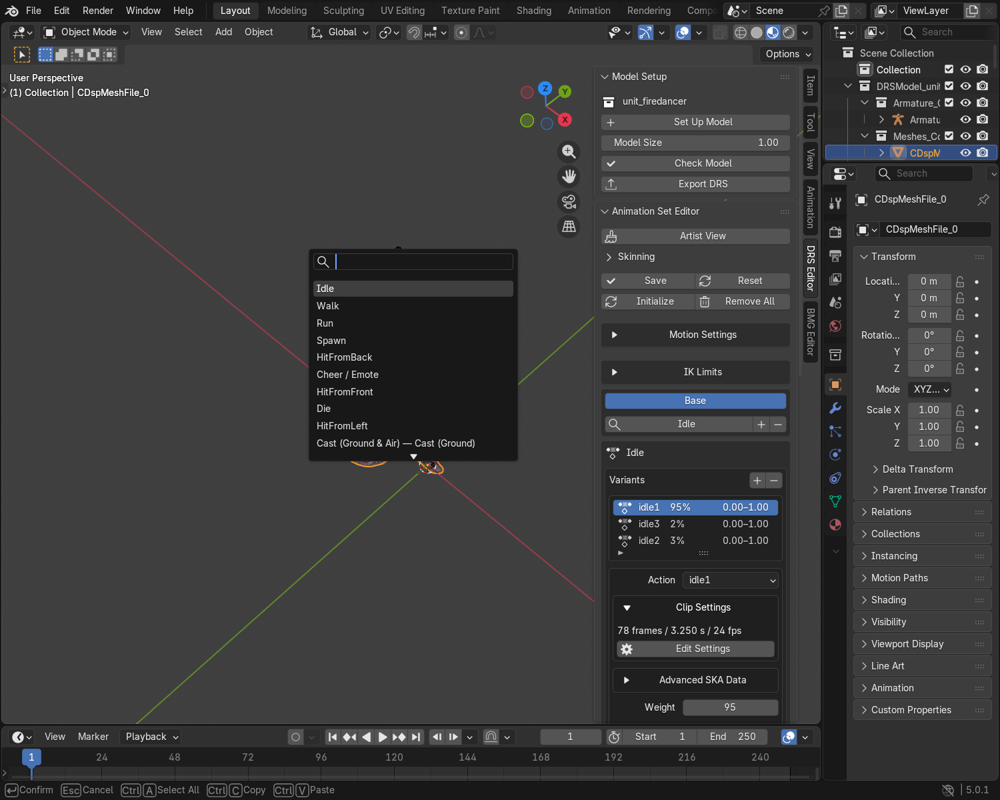
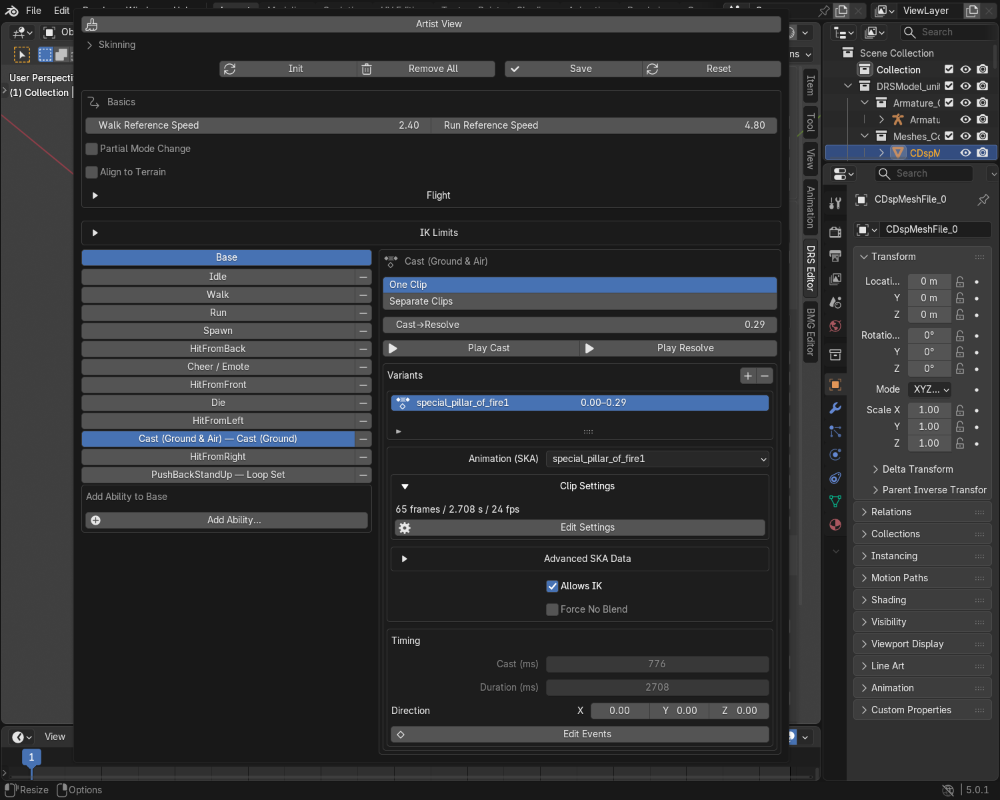
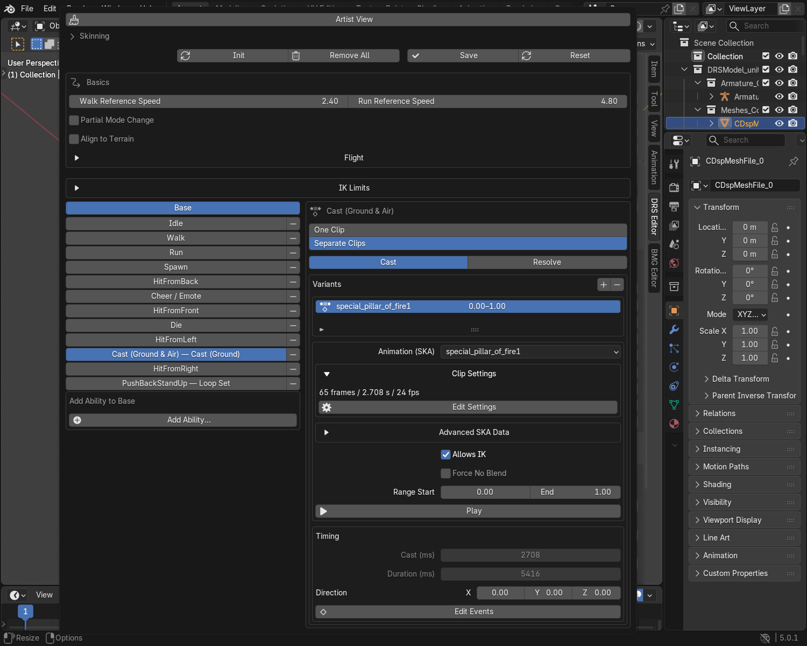
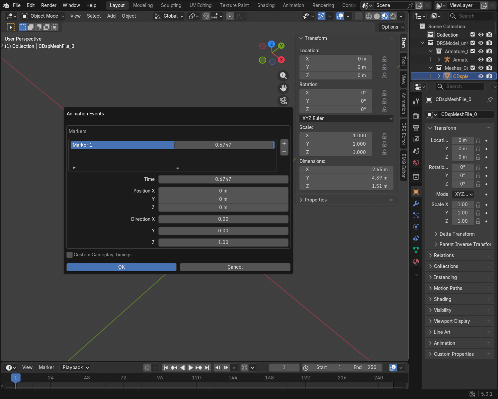
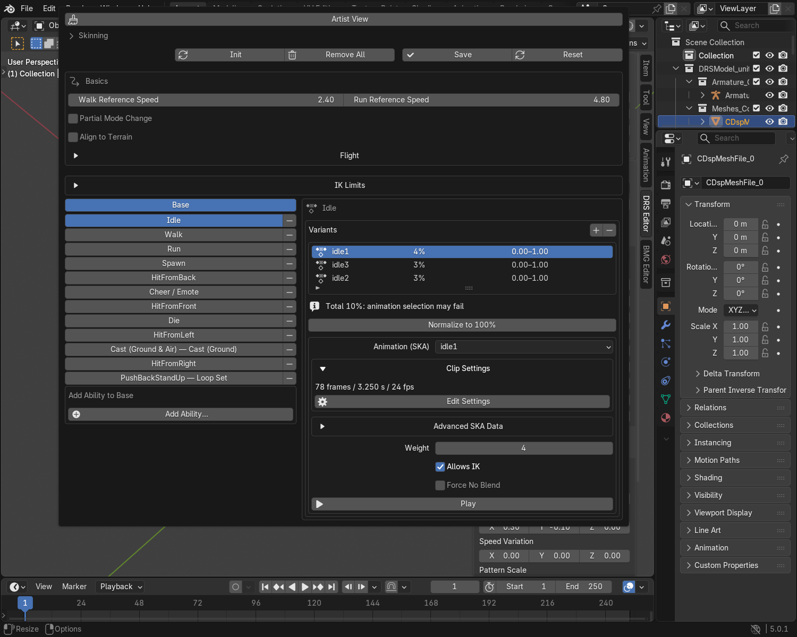

# Advanced Animation Tutorial

Build a cast, a multi-hit attack or a channelled animation with the
**Animation Set Editor**. Start with a model and working Actions on its deform
armature. For the initial setup, use the [Animation Set Guide](advanced_abilities_guide.md).

In a narrow sidebar, click the selected mapping's name to search the current
mode's animations. Ground/Air casts and phase groups remain grouped; select
their phase buttons to edit Cast, Resolve, Start, Loop or End.

## One Action for a cast and its recovery

Example: a two-second Action raises a staff, releases a spell after half a
second, then lowers the staff.

1. Add the **Cast** ability used by the unit's game setup.
2. Select its Cast entry and choose **One Clip**.
3. Assign the complete Action.
4. Set **Cast→Resolve** to **0.25**: the release is one quarter through the Action.
5. Check **Play Cast**, then **Play Resolve**.
6. Click **Save**.

The release occurs at 0.5 seconds; the recovery lasts 1.5 seconds. The editor
calculates both phase ranges and gameplay timings. You do not need to enter
milliseconds or duplicate the Action.

For Ground & Air versions of the same ability, keep the release and total
duration matching. Assign the corresponding motions to both entries.

!!! note "The game needs the matching ability"
    Adding a Cast entry supplies animation data. It does not create a spell,
    projectile, damage event or new gameplay job.

## Separate Cast and Resolve Actions

Use this when preparation and recovery already exist as different Actions.

1. Select the Cast entry and choose **Separate Clips**.
2. Click **Cast** and assign the preparation Action.
3. Click **Resolve** and assign the recovery Action.
4. Keep **Range Start / End** at **0 / 1** to use each complete Action.
5. Play each phase, then **Save**.

A 0.5-second Cast followed by a 1.5-second Resolve has the same release and
total duration as the One Clip example. The chosen layout changes how you
author the motion, not the ability's gameplay requirements.

Trim the Actions themselves when possible. Switching clip layout resets the
phase ranges. Imported separate clips remain separate until you change them.

## An attack with two hit moments

Example: one Action swings twice, with hits at 30% and 70% of the clip.

1. Select the matching Attack entry and its Action variant.
2. Open **Edit Markers**.
3. Add two markers and set **Time** to **0.3** and **0.7**.
4. Keep **Direction** at **0, 0, 0** for ordinary attacker-to-target pushback.
5. Confirm with **OK**, then **Save**.

The timings are generated from the markers and clip duration. The gameplay
ability must support both hits. Extra markers alone do not add damage.

After changing only clip length or FPS, check the timing readout. Unchanged
imported timings may be preserved instead of recalculated; edit the marker and
save again if an update is needed.

For a deliberate directional hit, use **Display Marker**, rotate its arrow
and click **Save Placement**. Keep an imported direction unless you intend to
change the hit response. Marker Position is stored, but it is not a projectile
spawn locator. Use the [Locator Editor](advanced_locators_guide.md) for that.

Add matching sounds and visuals separately in the Effect Set Editor, using
the same Action and Time. Follow the [Advanced Effects Tutorial](effects_advanced_tutorial.md#time-a-sound-and-a-visual-together).

## Start / Loop / End for a channelled ability

Use this only for an ability whose game setup already supports these phases.

| Phase | Author this motion |
|---|---|
| Start | Enter the channelled pose. |
| Loop | Repeat the sustained motion with a clean seam. |
| End | Leave the pose and recover. |

Choose **One Clip** and set the phase boundaries, or choose **Separate Clips**
and assign an Action to each phase. Check the phase playback buttons and save.
For separate clips, set the middle Action's **Loop** setting in **Clip Settings**.

A Spawn Action with several visual stages can stay in one clip. Adding three
Spawn variants creates three alternatives, not a three-part sequence.

## Alternative motions and mode banks

- Add Action variants for different ways to perform the same animation. Their
  **Weight** values are percentage chances, such as **80 / 20**; keep the
  assigned variants at **100% total**. Use **Normalize to 100%** to keep their
  proportions and calculate those percentages automatically.
- Matching Cast/Resolve or Start/Loop/End variants are kept together. Changing
  one phase's weight updates the corresponding phases.
- **Base**, **Mode 1** and **Mode 2** are separate animation banks. Use the bank
  selected by the unit's game setup; they do not mean Start / Loop / End.
- Keep a working **Base Idle** for units, including units with extra modes.

A total below 100% can select no animation. A total above 100% can leave later
variants unreachable. For example, **4 / 3 / 3** is not a 40 / 30 / 30 choice;
normalize it before using it for an ordinary animation mapping. The editor
does not silently change imported chances or deliberate edits.

Animated props use Idle automatically. For another exported SKA, use the
object's **Scripted animations** instructions. A map script must request it;
adding an unsupported automatic action does not make a prop use that action.

## Clip and movement checks

| Change | What to do |
|---|---|
| Loop seam | Set Loop in Clip Settings; check the first and last poses and their curve tangents. |
| Clip length | Edit the Action's keys, then confirm Clip Settings with OK. Imported end padding is retained. |
| Playback speed | Edit clip FPS. It changes duration without moving the keys. |
| Movement reference | Set Walk / Run Reference Speed to the speed that clip was authored for. It does not set gameplay speed. |
| Procedural look or walking limits | Use the [Advanced IK Tutorial](ik_advanced_tutorial.md). |

For an in-place walk or run, the plugin cannot infer the intended travel speed
from the keys. Start with a working equivalent unit's reference setting and
check its motion in-game. Do not set the reference speed to zero.

??? tip "Custom gameplay timings"
    Use **Edit Events → Custom Gameplay Timings** only for a deliberate timing
    override. **Event (ms)** is the trigger offset; **Total (ms)** includes
    recovery. For a hit at 500 ms in a 2000 ms sequence, enter 500 / 2000.

    These values stay fixed when you change clip length or FPS. Disable the
    override to return to marker/phase-generated timings. Check overrides with
    the matching gameplay ability.

??? info "SKA text events"
    **Advanced SKA Data** on the selected animation contains text events such
    as `<blink>`. These are separate from attack/spawn markers and Effect Set
    events. In the engine's facial-animation path, `<blink>` restarts a separate
    eye animation when the necessary facial resources exist. It is not a
    general-purpose marker for ordinary Idle clips. Blender preserves these
    events but does not play them; practical use in Skylords needs testing.

??? info "Set automatically; keep your attention on the motion"
    | Plugin handles | You choose |
    |---|---|
    | Keyed clip range when confirming Clip Settings; scene range and FPS when pressing Play | Keys, FPS, looping and interpolation |
    | Shared phase ranges and generated gameplay timings | Release/phase boundaries and Actions |
    | Marker class for new ordinary attack/spawn markers; animation file CRCs | Hit times and deliberate hit directions |
    | Corresponding phase weights | Alternative motions and their weights |
    | Bone lookup IDs and serialized versions | Bone names, rest pose and weighting |
    | Hovering timing attribute from Hovering Ground Unit | Whether the model uses the hovering motion path |

    CRCs, versions and internal timing selectors are hidden in Artist View.
    Existing imported records are preserved. The plugin does not invent
    gameplay abilities, target behaviour, movement speed or IK chain order.

## Final check

Save the Animation Set and run **Model Setup → Check Model**. It reviews saved
animation chances and clip ranges, along with mesh and material checks.
Use **Normalize to 100%** for an ordinary mapping with a non-100 chance total.
An unloaded external SKA reference is kept; load Animation Clips to preview it.

Export the intended DRS and SKAs, then reimport a copy.
Check Idle and every assigned variant. Check phase transitions, hits, pushback,
movement and procedural IK with the game setup in the Map Editor or game.
Blender's single-clip Play button does not simulate the complete gameplay state machine.

??? info "Switching models and recovering an edit"
    Pending animation edits stay with their model during the current Blender
    session, including the selected entry. They are not saved animation data
    until you click **Save** in the editor. Save each edited model before
    saving your `.blend` or exporting it.

    If saved settings changed while a draft was kept, the editor tells you.
    **Save** applies your draft; **Reset** loads the saved settings instead.
    Opening a `.blend` clears these session drafts and loads its saved settings.

    If settings cannot be loaded, keep your source files and reimport a working
    model copy. **Check Model** identifies unreadable saved records. A failed
    read does not replace another model's pending draft.
