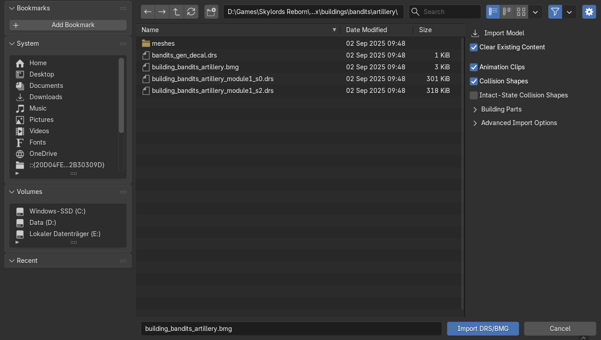
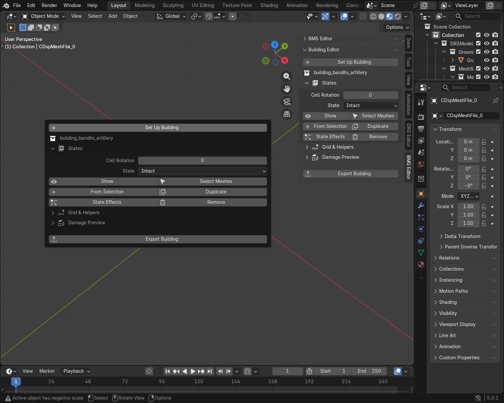
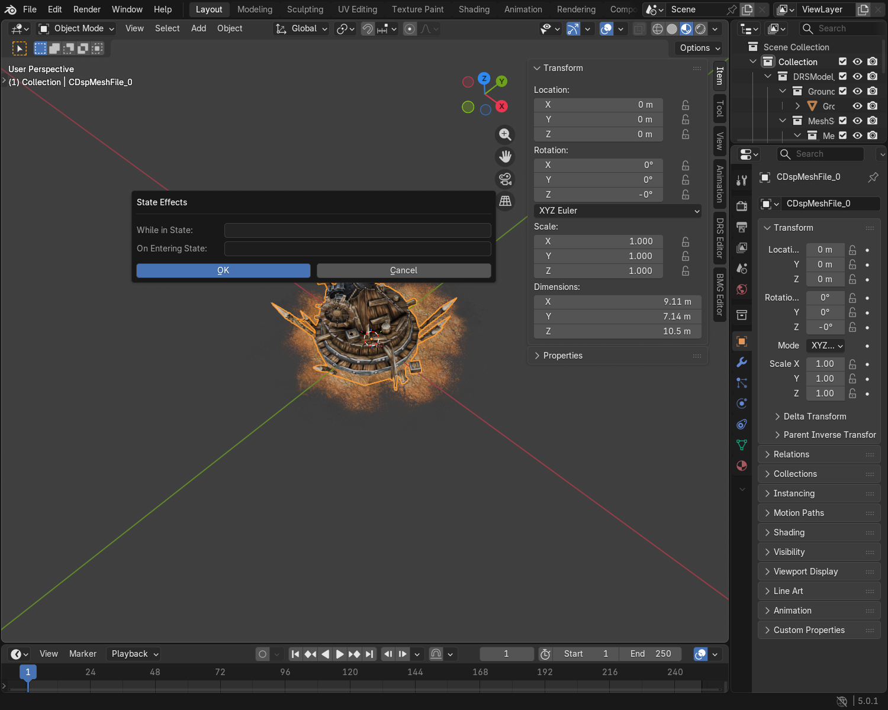
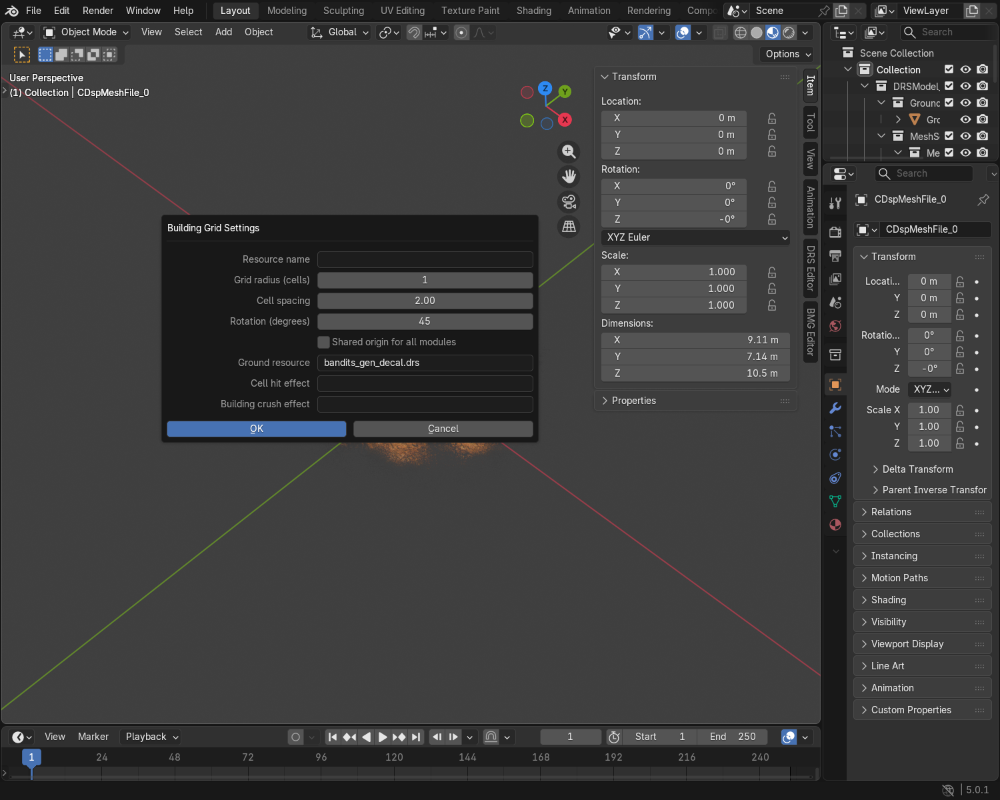
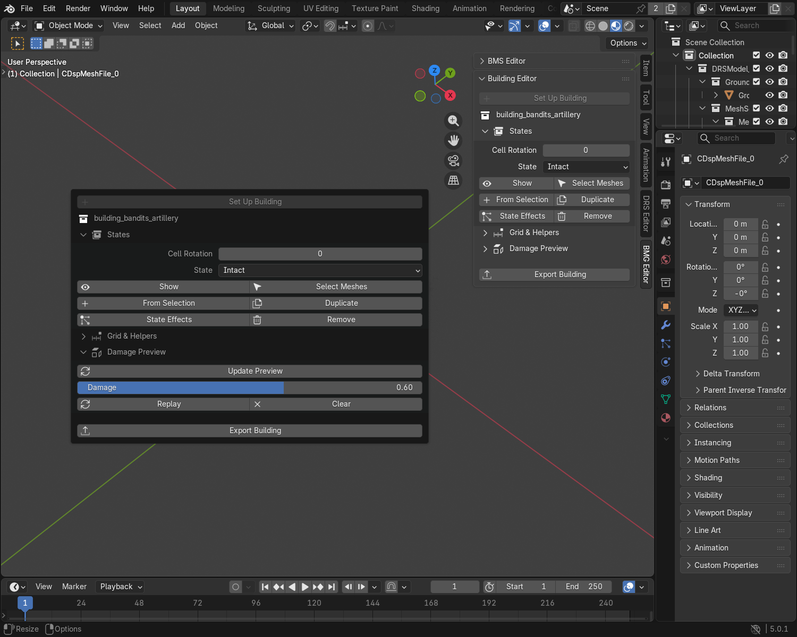
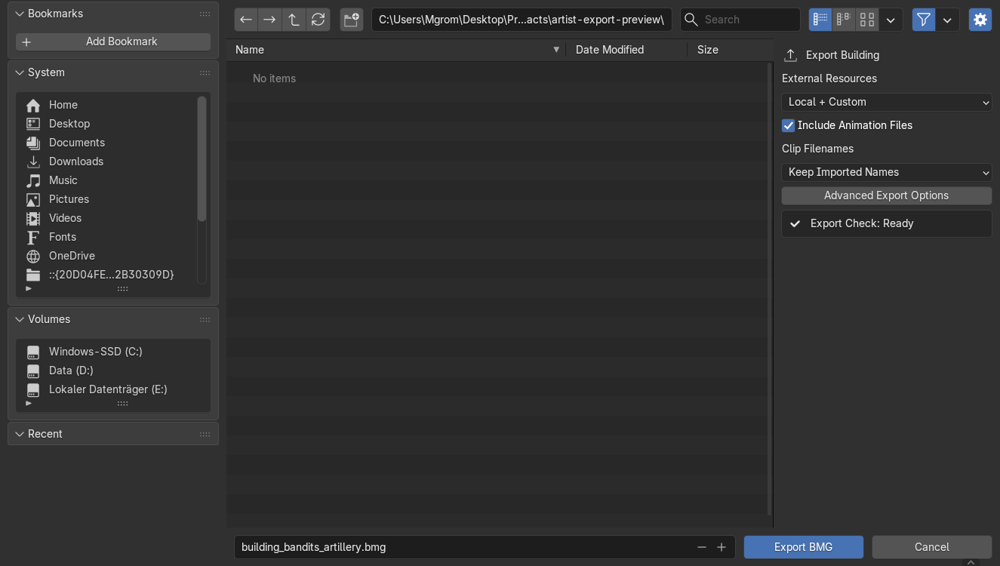
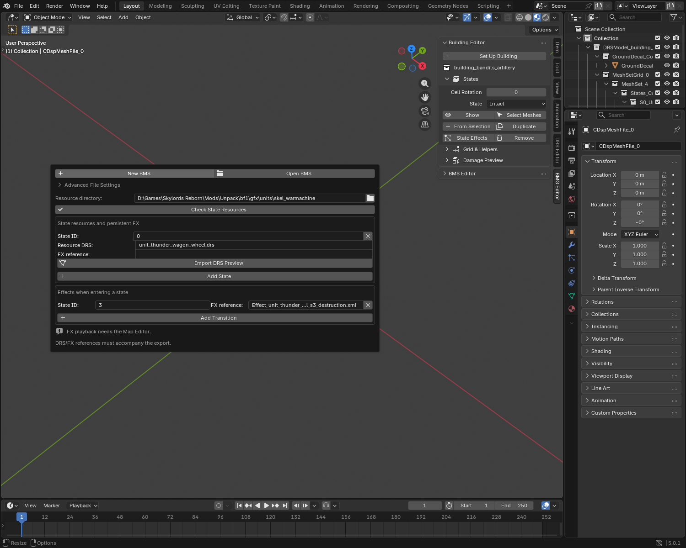

# Building Guide

Create or edit a building with intact, damaged and destroyed states. For ordinary
props, use the [Object Guide](object_creation_guide.md).

## Cells and states

- A **cell** is a building section that can be damaged separately, such as a wall
  section. A small building can use one cell for the whole model. A cell can
  contain several meshes.
- A **state** is a version of that section: intact, damaged or destroyed.
  Choose a cell first, then the version you want to edit.

You do not need to create the state collections or work out file links by hand.

## 1. Start a building

**Existing building:** use **File → Import → Battleforge Model (.drs/.bmg)**, then select one
of its meshes. Enable collision or debris import if you intend to edit those parts.

Enable **Collision Shapes** and **Intact-State Collision Shapes** to edit
intact cells' collisions too. Disable **Clear Existing Content** to keep existing
models and Actions, including those in other scenes. **Building Parts** contains Construction Geometry and Debris Geometry.

**New building:** select your meshes, open **BMG Editor → Building Editor**,
and click **Set Up Building**. This creates the intact state from your selection.
Use the [Object Guide](object_creation_guide.md) for UVs and DRS materials.

For a **new animated building**, prepare the rig and GameOrientation using the
[Unit Guide](unit_creation_buide.md), then select its meshes and click **Set Up
Building**. Use one armature, with its object transforms applied in
GameOrientation. The plugin copies the skeleton and adds an Idle starter.
Assign your Idle action in **Animation Set Editor**.

The plugin creates GameOrientation, a **3 × 3 grid**, and an **Intact** state
in the centre cell `(0, 0)` containing your selected meshes. The other cells
start empty. You can use this setup for a complete small building.

**Duplicate** creates another state from an existing one. **From Selection**
creates the chosen cell/state assignment from your selected meshes. Export
writes the state resources and their references automatically.

The plugin does not split your building into sections or sculpt damage for you.
For separate damageable sections, prepare their meshes and add them to different
cells with **From Selection**. For a damaged appearance, edit a duplicated state.

!!! info "GameOrientation"
    Keep the building's **GameOrientation** unchanged. Keep imported meshes
    attached to their existing armature or parent. New meshes copied with
    **From Selection** keep their visible placement.

## 2. Edit a state

1. Open **States**. For a building with several parts, choose a **Cell**.
2. Choose a **State**, then click **Show**.
3. Click **Select Meshes** and edit normally.

**Intact** is state 0, **Damaged** is state 2, and **Destroyed** is state 3.
Some assets also define **Damage Stage 1**. The picker lists the states that
actually exist in the selected cell.

For ordinary building damage, prepare **Intact** and **Damaged**. The game
switches to Damaged when the cell reaches its damage threshold and to Destroyed
when the building is crushed. **Damage Stage 1** is available for existing or
special setups; adding it alone does not make the ordinary damage system switch
through it. Test the building with its intended game setup.

The creation dialog offers four named states per cell. Other state IDs can
exist in imported files, but we have not established a universal engine limit
or automatic damage behavior for them.

To create damaged geometry, show **Intact**, click **Duplicate**, choose
**Damaged**, and edit the copy. Its mesh data and collision shapes are independent.
If no visible damage is needed, keep that Damaged copy unchanged.

For a simple building, keep using cell `(0, 0)`: make **Intact**, duplicate it as
**Damaged**, then remove or change parts of that copy. Add a **Destroyed** mesh
only if something should remain visible, such as a ruined base.

To use different meshes, select them and click **From Selection**. Choose the
cell coordinates and the new state. The selected meshes are copied.

Use **Remove** to remove the selected state from this building. Undo restores it.
For multi-cell buildings, **All Cells** makes **Show** display that state in each
cell that defines it. Other buildings are not changed.

### State effects

Click **State Effects**:

- **While in State:** the persistent effect for this state.
- **On Entering State:** the effect that plays when the building enters it.

For example, assign smoke to **While in State** for a damaged building, and a
burst of debris to **On Entering State** for destruction. Leave a field blank
if you do not want that assigned effect.

Enter an existing FXB or supported destruction XML reference. A destroyed state
can have a transition effect without a model. **No imported mesh** is normal for
such a state. Create or modify effect assets in the external Effect Editor.

## 3. Check the grid and collisions

Open **Grid & Helpers**:

- **Grid Overlay** shows the building's cells on the ground. It is not rendered or exported.
- **Collision Shapes** and **Locators** show or hide this building's helpers.
- **Edit Grid** changes grid dimensions, spacing, rotation and building-level resources.
- **Building Size** resizes the entire building, including its cells, states,
  collisions, attachment positions and SKA animations. `0.5` is half size;
  `2` is double. Export includes the resized clips automatically.

A grid radius of `0` gives **1 × 1 cells**; `1` gives **3 × 3**; `2` gives **5 × 5**.
Keep the imported settings unless you intend to change the building layout.

??? tip "What the Edit Grid settings mean"
    | Setting | What you use it for |
    | --- | --- |
    | Resource name | Name stored with this building. The export filename is chosen when exporting. |
    | Grid radius | Number of cells available around the centre cell. Enlarging the grid adds empty cells; it does not split the model. |
    | Cell spacing | Distance between neighbouring cells, in game units. It does not resize your meshes. |
    | Rotation | Orientation of the whole building grid. Keep GameOrientation unchanged. |
    | Shared origin for all modules | Enable when the sections are modeled together at one building origin. Keep the imported setting on existing assets. |
    | Ground resource | Optional DRS beneath the building, such as its ground decoration. It does not create terrain. |
    | Cell hit effect | Building-level hit/debris effect used when an individual cell is damaged. |
    | Building crush effect | Effect for destruction of the whole building. |

    **Cell hit effect** and **Building crush effect** are separate from the
    persistent and transition effects assigned with **State Effects**. Blank
    building-level hit/crush fields allow the engine's standard building effects.

    Additional cells do not make the ground walkable or create collision shapes.
    Place collisions separately where needed.

Edit collision shapes using the [Object Guide](object_creation_guide.md#8-create-collision-shapes).
Use the selected state's collision collection for state-specific shapes and the
building's root collision collection for building-wide shapes.

## 4. Preview damage

1. Open **Damage Preview** and click **Build Preview**.
2. Drag **Damage** to inspect damaged geometry, scratch and destruction effects.
3. Press **Space** to animate debris and FX. Use **Replay** to restart the transition.
4. Use **Update Preview** after changing geometry, effects or terrain.
5. Click **Clear** to return to editing.

The slider is a preview, not the building's exported health. Manual **Show**
controls also leave the damage preview. After reopening a saved preview,
rebuild it or clear it.

Scratch requires a scratch map with useful alpha. A white mask produces no
visible darkening. Missing states are not replaced with invented geometry.
Build once, then use the slider: effects are cached across the building's states.
Changing Damage within the same state keeps its current effects running.
Use **Replay** when you want to restart them.

## 5. Export

1. Save your working `.blend`.
2. Open **File → Export → BattleForge Building (.bmg)** and choose a separate output folder.
3. Keep **Advanced Export Options → Model Type** at **Automatic (Keep Imported Setup)**.
4. Keep **External Resources → Local + Custom**. Include animation files if you changed animations.
5. Reimport the exported copy, then test it in the Map Editor.

Read **Export Check** before exporting. Fix errors such as missing materials,
UVs or building states. Save pending changes in **Animation Set Editor** and
**Effect Set Editor**. If an included clip is missing, load it or restore its
source file. Review items do not block export.

Export includes hidden states, state DRS files, textures, local destruction XML
and its `meshes/` resources. Custom global dependencies go into **AdditionalFiles**.
Review `<building>.assets.json` and `<building>.bmg-export.json` before sharing.

To edit debris, destruction XML or module resources, follow
[Modules, Debris & Resources](external_resources_guide.md).

??? tip "Advanced: modular buildings and animations"
    Keep **Shared origin** enabled for sections modeled together at one building
    origin. Disable it for separate modules placed by the grid. Select a cell
    and use **Cell Rotation** to turn that module and all its states.

    Animate the building's main armature. The plugin keeps its cells in sync;
    you do not need to animate the hidden cell helpers. Imported states retain
    their individual skeleton bindings.

    Building Size leaves external FX assets at their own size. Adjust those
    resources in the external Effect Editor when they need different dimensions.

??? tip "Advanced: standalone BMS state files"
    Use this for a separate state-resource module. Ordinary BMG editing uses
    **States** above and writes those links for you.

    1. Open **BMG Editor → BMS Editor** and choose **Open BMS** or **New BMS**.
    2. Set **Resource directory** to the folder containing the referenced files.
    3. For each state, enter its **Resource DRS** and optional **FX reference**.
       The FX runs while that state is active.
    4. Use **Add State** for another version. Common building IDs are `0` Intact,
       `2` Damaged and `3` Destroyed. Keep the imported IDs for other modules.
    5. For an effect when a state begins, use **Add Transition** and enter its
       destination **State ID** and **FX reference**.
    6. Use **Check State Resources**. **Import DRS Preview** opens a referenced
       model for editing; export that DRS separately after changing it.
    7. Open **File → Export → BattleForge Mesh States (.bms)** and keep the referenced DRS and FX assets available.

    

    Leave **Advanced File Settings** unchanged for an existing module. A BMS
    does not pack the models or effects into one file. Local resource checks
    need loose files; engine-resolved assets in archives may still be available
    in the game. Check the final module and FX in the Map Editor.

??? tip "Advanced: construction and debris"
    BMS files describe state resources; they do not contain mesh geometry.
    Use **BMG Editor → BMS Editor** for standalone BMS references. Construction
    and destruction XML/FX graphs are separate assets and need their own editor.

    Blender previews use cached debris physics and bounded particles. Exact
    engine collision/inertia, gameplay impulses, spatial audio and all shader
    effects are not reproduced. Test the final result in the Map Editor.

For materials and animation events, see the [Material Guide](material_artist_workflow.md)
and [Effects Guide](advanced_effects_guide.md).
