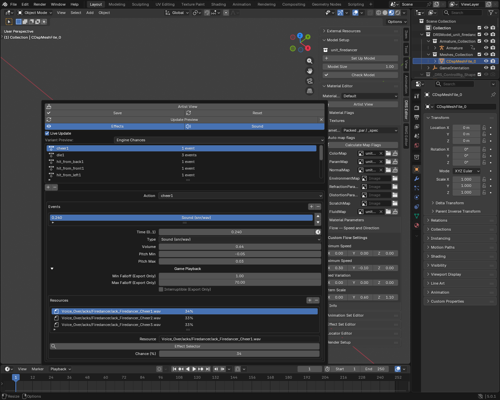

# Advanced Effects Tutorial

Time existing sounds and effects, attach continuous effects, and check their
preview. Create the FX resources themselves in the external Effect Editor.
Start with the [Effect Set Guide](advanced_effects_guide.md) if your library is not set up.

## Time a sound and a visual together

Example: an attack should play an impact sound and a burst at 30% of its Action.

1. Play that Action in **Animation Set Editor**, then pause at the impact pose.
2. Open **Effect Set Editor** and add an animation entry. It selects the
   Action currently assigned to the model's armature.
3. Add an event. Choose **Sound**, then use the clock button beside **Time**
   (**Use Playhead** on hover).
4. Open **Effect Selector**, choose the sound and keep its **Chance at 100%**.
5. Add another event, choose **World FX**, set **Time** to the same value and
   select the visual resource at **Chance 100%**.
6. Click **Update Preview**, enable **Sound** and press **Space**.
7. Adjust placement and volume, then click **Save**.

Two events play two layers. Two variants in one event choose between them.
Use a separate Sound event for each simultaneous sound layer too.

**Use Playhead** reads a fraction of the whole Action, including its stored
end padding. Play the selected Action on the model first; a different active
Action cannot supply its time. The event can be at 0.3 even when the current
Blender frame is not frame 30.

If an attack uses a hit marker, set the FX event to that marker's Time. A marker
does not create a sound or visual event automatically.

## Choose World FX, Linked FX or a locator

| Wanted result | Use |
|---|---|
| Burst at an animation moment, placed with Offset | World FX event |
| Existing FX with its own source/target or controller setup | Linked FX event |
| Fire attached continuously to a hand, weapon or body | Persistent FX locator |
| Destruction tied to a building's damage state | Building Editor → Damage Preview |

For a hand flame, open **Locator Editor**, add a **Persistent Figure FX**
locator, attach it to the intended bone, choose the effect and save placement.
Follow the [Locator Guide](advanced_locators_guide.md#choose-and-preview-an-effect).

An event's Offset is not a bone attachment. Do not keep nudging an unattached
World FX event to make it follow an animated hand.

## Fade an attached effect during an Action

Example: a persistent hand flame should fade out halfway through a clip and
return near its end.

1. Set up and preview the persistent locator first.
2. In that Action's EffectSet entry, add **Fade Out Persistent FX** at **Time 0.5**.
3. Use the **same effect filename** as the persistent locator.
4. Set **Fade Duration (s)**, for example **0.2**.
5. Add **Fade In Persistent FX** at **Time 0.9**, using the same resource name.
6. Update the preview, play the clip and save.

Fade events affect an effect that already exists. They do not spawn a new one.
If a fade has no effect, compare the event and locator filenames first.

## Alternatives, occasional sounds and silence

| Event variants | Result |
|---|---|
| 40 / 30 / 30 | Always one of three resources |
| 80 / 20 | Always one of two resources |
| One variant at 25 | A resource on 25% of choices; otherwise silence/no FX |
| 4 / 3 / 3 | 90% chance of silence/no FX |

Click **Normalize to 100%** when you want to keep the proportions but always
choose a resource. This changes the saved chances; it is not a preview setting.
Avoid totals above 100%.

Use **Selected Variant** while checking each sound or visual. Switch back to
**Engine Chances** to preview the saved choices. A single event's random choice
does not have to match a live game's random sequence.

## Sound variation and game playback

Keep **Volume** and **Pitch Min / Max** in the event's main controls. For a small
pitch variation, use **−0.05 / 0.05**. Zero leaves playback rate unchanged;
pitch changes also change duration. Keep the playback rate positive.

Open **Game Playback** for the settings that require an in-game check:

- **Min / Max Falloff:** the sound's distance settings. Blender timeline audio
  does not reproduce positional attenuation. Keep a working imported range
  until you can test it in-game.
- **Interruptible:** controls handling when an animation is interrupted.
  An uninterrupted Blender timeline cannot demonstrate that case.

The stored Condition is retained in Debug View. The inspected animation-event
path does not use it for filtering; leave it unchanged.

## Preview and edit efficiently

1. Build once with **Update Preview**.
2. Keep **Live Update** enabled while adjusting event time, variants, volume,
   pitch or offset. Changes rebuild after a short pause.
3. Press **Space** for the shared timeline; flow and FX do not need separate clocks.
4. Rebuild after changing the model's motion, terrain contacts or external resources.
5. Turn **Effects** off to return to plain model animation, or **Sound** off for
   a silent FX preview. Turning Effects on reuses the cached preview. Use **×**
   beside Update Preview to remove the generated FX and audio completely.

For effects touching the floor, place a terrain mesh outside the model's export
collection before rebuilding. Without a terrain mesh, the preview uses flat ground.

Add **Render Setup → Add Render** and use **F12** to inspect supported refraction
and glow. Check the effect from several angles. Transparent particle sorting,
heat haze, scene fog and some gameplay links still need the Map Editor or game.

??? info "Effects with their own animation controller"
    Keep the referenced DRS, SKA, meshes and textures available in the library.
    The preview loads supported controllers automatically; you do not need to
    create another armature or assign the effect's Action to the unit.

    If an effect is misplaced or incomplete, read **Effect Preview Report** in
    Blender's Text Editor. Check missing dependencies and attachment targets
    before changing the unit's animation. Do not edit generated preview meshes.

??? info "Automatic preview setup"
    The plugin resolves installed resources, shares loaded assets, builds
    supported geometry/materials and applies the effect's animation tracks.
    Billboard masks, texture-atlas animation and supported UV offset/zoom come
    from the resource; no extra switch is required in the model's EffectSet.

    These previews are generated helpers and are excluded from model exports.
    Gameplay interruption, spatial audio and unavailable target links still
    need an engine check. A missing dependency is not replaced with a matching-looking effect.

## Share the result

Save the EffectSet and `.blend`, export the model and its intended SKAs, and
include custom external FX plus their dependencies separately. Reimport a copy
and check both the selected variants and the saved chance settings in-game.

Before exporting, run **Model Setup → Check Model** after saving the editors.
It flags empty resources, invalid event values and totals above 100%. A valid
chance of silence below 100% is kept and is not reported as a mistake.
