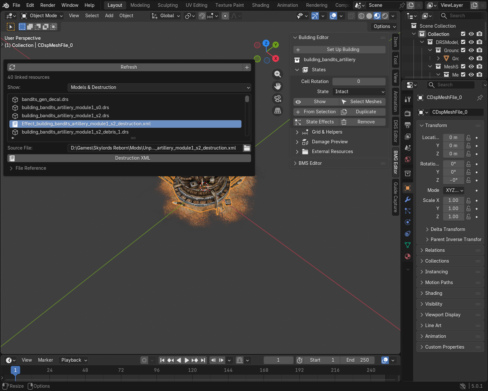
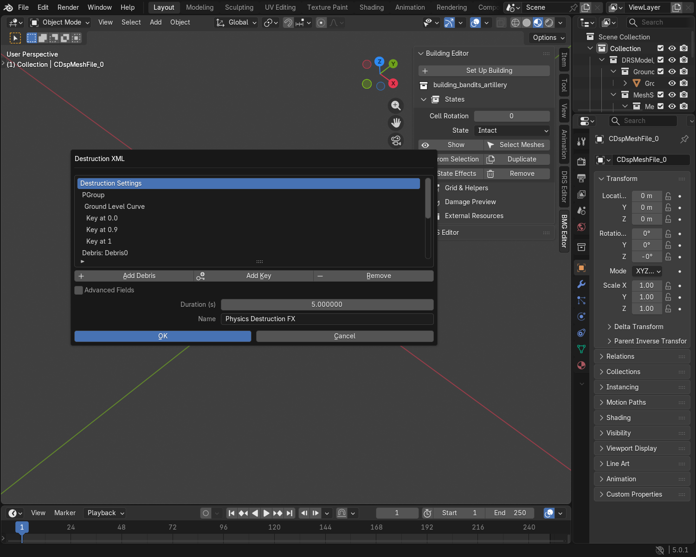
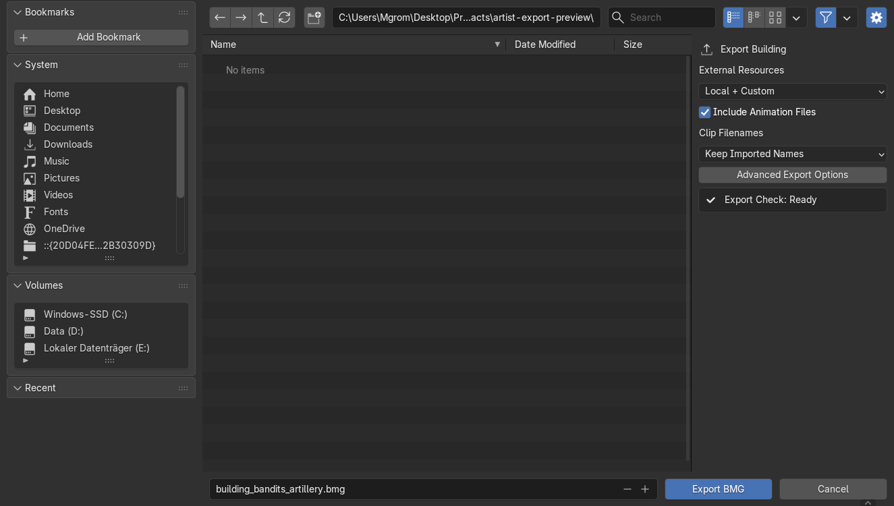

# Modules, debris and external resources

Use this guide when a model needs more than its main DRS or BMG: modules,
damage-state meshes, destruction XML, effects, textures or sounds.

## 1. Find the model's files

1. Select your model.
2. Open **External Resources** in DRS Editor. For a building, open it inside
   **BMG Editor → Building Editor**.
3. Click **Find Resources**.
4. Use **Show** to choose models, effects, textures or audio.

Select a file to see its **Source File** and available editing tools.
**Refresh** checks the references again after you change a locator or effect.

[](../assets/images/guides/editors/building-resources.png)

## 2. Edit destruction settings

For a building, choose a damaged or destroyed state and click **Edit Destruction**.
You can also select its XML in External Resources and click **Destruction XML**.

1. Select **Destruction Settings** to change the duration.
2. Select a **Debris** entry to change its name or model filename.
3. Select its **Priority** entry to change which pieces take priority when the
   game limits debris. Priority does not change the piece's mass.
4. Select a curve or key to change its timing and values.
5. Click **OK**, then save your `.blend`.

Changes stay in the `.blend` and are included on export. The source XML stays unchanged.

[](../assets/images/guides/editors/building-destruction.png)

| Control | Use |
| --- | --- |
| Duration | How long the effect or selected curve runs, in seconds. |
| Time (0–1) | Position within that curve: 0 is its start, 1 is its end. |
| Ground Level | Debris collision-plane height. Lower it near the end to let pieces sink away. |
| Alpha | Fade: 0 is invisible, 1 is fully visible. |
| Add Debris | Add a piece, then enter the DRS filename it should use. |
| Add Key / Remove | Add a curve key, or remove the selected key or piece. |

Use **Build Preview** or **Update Preview** in Damage Preview to see the saved
changes. Space plays the preview.

??? tip "Advanced: curves and other XML fields"
    Each curve has its own duration. Changing the effect duration does not rescale
    its curves. Select the curve itself to edit its duration and addressing mode.

    **Advanced Fields** reveals attachment settings and other stored XML fields.
    Existing fields and comments are retained. Some native XML settings have no
    Blender preview; test their exported result in the Map Editor.

## 3. Edit a debris or module model

1. Select its DRS in **External Resources**.
2. Click **Edit Resource Model**.
3. Edit the imported mesh, materials or collision as usual.
4. Select the main model again before exporting it.

The edited resource is included with its owner. If you imported a building with
**Debris** enabled in this version, edits to those imported debris meshes are also
included. For an older `.blend`, reimport the debris or use **Edit Resource Model**.

For a module BMS, click **Edit Mesh States**. Make the changes in
**BMG Editor → BMS Editor**. They are included when you export the main model.

Use **Edit Resource Model** for module geometry or animation edits. Locator
module previews are for placement; the export check stops if those preview
meshes were changed, so their edits cannot be silently lost.

## 4. Use your own effect or file

1. Give the new resource a unique filename in your working folder.
2. Set that filename in the model's Locator, Effect Set or State Effects settings.
3. Click **+** in External Resources.
4. Enter the same **Referenced Filename** and choose its **Working File**.

To replace a file already listed, change its **Source File** to your working copy.
Refresh the effect or damage preview after changing resources.

Use unique filenames to keep the original effect available. Replacing an existing
global filename affects every model that uses that filename after installation.

??? tip "Advanced: effect editing and shared resources"
    Create or edit FXB effects in the Effect Editor, then bind the resulting file
    here. For sound sets, keep every audio variant and any SNR/SNS pair together.
    Use game-ready resources; this exporter does not convert source WAVs to the
    game's audio format.

    Multiple locators can share one module. Editing its resource changes all uses
    of that file. To give one locator a different version, use a separate filename
    and update that locator's reference.

## 5. Export the package

1. Open **File → Export → BattleForge Model (.drs)** or **BattleForge Building (.bmg)**.
2. Keep **External Resources → Local + Custom**.
3. Choose a separate export folder and export.
4. Review `<model>.assets.json` for files that were not found or were left as
   installed-game references.

Standalone **BattleForge Mesh States (.bms)** exports offer the same resource
choices and include their referenced state models and destruction files.

[](../assets/images/guides/editors/building-export.png)

Everything is written inside the export folder you chose. It can contain:

```text
my_building.bmg
my_building_cell…drs
animation.ska
destruction.xml
textures.dds
meshes/
    debris_piece.drs
AdditionalFiles/
    INSTALL.txt
    bf1/gfx/effects/…
    bf1/sound/…
my_building.assets.json
```

Keep the main model, module files, XML, textures and `meshes/` together in a
dedicated model folder. Point the object's game resource entry at that model.
For a new copy of an existing model, use a new model folder to keep its local
XML and debris separate from the original.

### Open the exported model in Blender

Keep **AdditionalFiles** beside the main `.drs`, `.bmg` or `.bms`, then import
that main file. Blender uses the packaged resources first and the configured
Skylords installation for anything the package does not include. If neither
contains a resource, the error names the missing file.

You can move or share the whole export folder. You do not need to install its
files in the game to import or preview it in Blender.

### Install for a game test

Copy **AdditionalFiles/bf1** into **Skylords Reborn/Mods/Unpack**, preserving
`bf1/...`, as listed in **INSTALL.txt**. Keep the model's local files together
in their dedicated model folder. Test the complete package in the Map Editor.

??? tip "Advanced: export choices"
    **Local + Custom** includes local module/state/destruction resources and
    custom or edited global dependencies. Unchanged global game assets remain
    references. **Include Original** on a resource also packages that original.

    **All References** also copies unchanged global dependencies. It can create
    a much larger package. **Model Files Only** skips dependency packaging.

    Main-model clips follow **Include Animation Files**. Referenced module and
    custom-effect controllers retain the animation files they need.

    Detection uses the configured Skylords folder, working-file bindings and
    recorded file fingerprints. An original modified before its first scan cannot
    be identified as an edit automatically; bind a working copy or include it
    explicitly. Unrecognized or missing dependencies are listed in the manifest.
