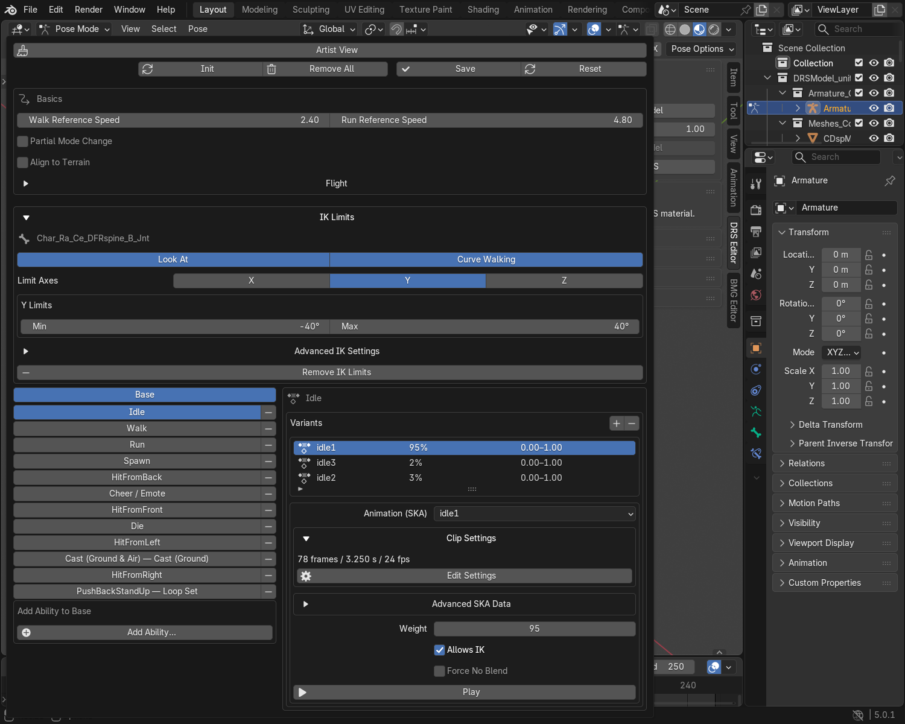
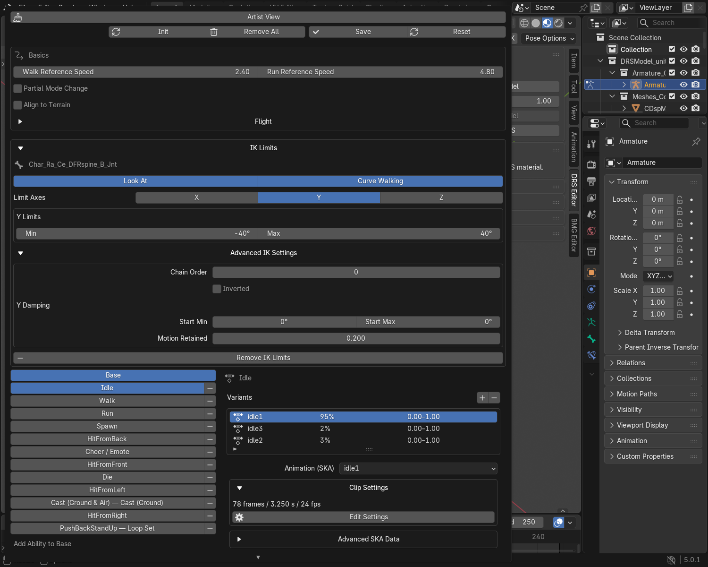

# Advanced IK Tutorial

Edit the limits used by the game's procedural IK, or bake a Blender IK rig
into an ordinary animation. These are two different workflows.

| Your goal | Workflow |
|---|---|
| Adjust a working unit's procedural look/walking limits | Edit **IK Limits** below. |
| Animate with Blender controllers and export the resulting motion | [Bake onto the deform rig](#bake-blender-ik-into-a-ska). |

## Adjust an imported IK bone

Use an existing unit with a working IK setup for your first edit.

1. Select the model's deform armature and enter **Pose Mode**.
2. Select a bone with imported IK data.
3. Open **Animation Set Editor → IK Limits**.
4. Click **Edit Angle Limits** if the angle controls are not present yet.
5. Edit Min / Max for an enabled axis. For a small test, tighten one existing
   range slightly rather than changing every bone.
6. Keep the bone's purpose and chain settings, export the DRS and check the
   procedural response with the matching unit in-game.

Select **X**, **Y** or **Z** to enable or disable a limit axis. Only enabled
axes show their angle controls. Disabling an axis does not erase its stored values.
Keep the imported rest pose and bone orientation while comparing changes.

!!! note "Normal playback does not demonstrate game IK"
    The game supplies procedural targets and movement state. These limits do
    not create a look target or a foot-placement solver in Blender.
    The generated Limit Rotation constraint stays muted so your keyed Action
    is not altered. Use ordinary playback to check the base animation, and
    an engine test to check the procedural response.

## Choose which IK setup uses the bone

**Look At** and **Curve Walking** select the engine IK purposes for this bone.
A bone can belong to either or both. Keep the purposes from a working
equivalent model unless you are rebuilding its procedural setup.

In each Action variant, leave **Allows IK** enabled when the game should apply
its procedural IK during that animation. Disabling it for a clip does not remove
the bone's limits from the model.

## Advanced IK Settings

Expand **Advanced IK Settings** for chain order, inversion and damping.

| Setting | What to edit |
|---|---|
| Chain Order | Preserve the imported order. Bone parenting alone is not enough to generate the intended engine chain order. |
| Inverted | Preserve this engine purpose flag unless you are deliberately rebuilding the IK setup. |
| Start Min / Max | Damping-start angles for that enabled axis. Keep them consistent with the working bone's angle limits. |
| Motion Retained | How much rotation beyond the damping start remains: **1** keeps it; **0** stops at the start angle. Hard Min / Max limits still apply. |

Example: with **Start Max 20°**, an attempted rotation of **40°** becomes
**20° at 0**, **30° at 0.5**, or **40° at 1**, before the
hard limits are applied. Lower Motion Retained values give stronger damping. A pose inside
the damping-start range is unaffected by this step.

Change one setting at a time and compare in the engine. The Blender constraint
does not reproduce the game's complete damping solver. There is no automatic
chain rebuild or procedural-IK preview to validate a new setup for you.

## Add or remove an IK entry

For a bone without imported IK, click **Add IK Limits**. Choose its purposes
and axes, then adjust its limits. New entries start with the plugin's basic
defaults; they are not a finished procedural rig. Use a working equivalent
model as a reference for the chain setup and test the new model in-game.

**Remove IK Limits** removes only that bone's exported IK entry and the plugin's
limit helper. Its animation keys and other bones' entries remain intact.

Bone lookup IDs and supported record versions are written automatically.
You do not need to type a bone index or calculate a flag mask. Hidden imported
axes, unknown purpose bits and other untouched data are retained.

## Bake Blender IK into a SKA

Use this when the desired motion comes from a Blender IK constraint or control rig.

1. Keep an editable copy of your original rig and Action.
2. Bake the evaluated **Pose** motion onto the model's deform armature with
   **Visual Keying** enabled. Include every deform bone that needs motion.
3. On the export copy, mute the controls/constraints that would apply that
   motion a second time. Play the baked Action to check the result.
4. Check that the deform bones have quaternion rotation curves. SKA exports
   translation and rotation. For a whole-model size change, use **Model Setup →
   Model Size**; it updates the skeleton and animation translations. Redesign
   animated bone scaling as translation/rotation motion for a SKA export.
5. Assign the baked Action in **Animation Set Editor**, confirm **Clip Settings**
   and save the animation set.
6. Export the DRS and SKA together, then reimport a copy and compare the motion.

Do not change the rest pose after baking without updating the model and its
animations together. An imported control rig is not a replacement for the
export deform skeleton.

!!! tip "Which parts are automatic?"
    **The plugin handles** bone lookup mapping, serialization and preservation
    of untouched IK data. **You choose** the intended pose limits, purposes,
    chain setup and any Blender bake. Game targets and gameplay behaviour
    cannot be derived from an Action's keys.

Return to the [Advanced Animation Tutorial](animation_advanced_tutorial.md)
for phase timing, hit markers and final animation checks.
