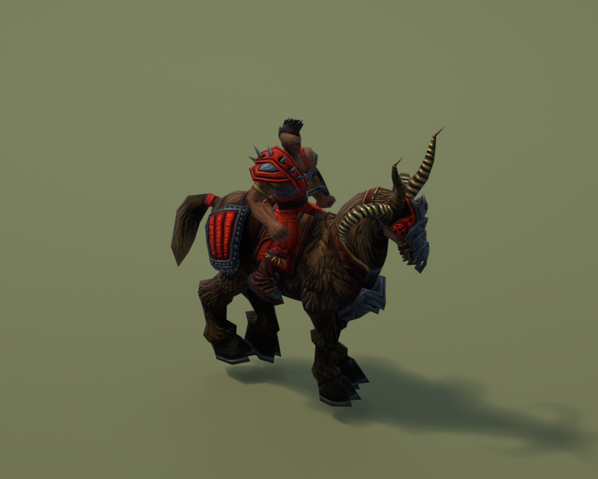

# Default Material Guide

Use this guide to set up **Default** materials in Blender 5. Other material
types are covered in the [advanced reference](advanced_shading_guide.md).

## 1. Open the Material Editor

1. Select the part of your model you want to edit.
2. In the 3D Viewport, press **N** and open **DRS Editor > Material Editor**.
3. If needed, click **Create DRS Material** or **Create / Upgrade DRS Material**.
4. Set **Material Type** to **Default**. Stay in **Artist View**.

An imported model usually already has its material. Upgrading an older setup
creates a new material and keeps the old one. Check the textures afterward.

## 2. Add your textures

Open **Textures**. Assign each image to its matching slot and tick the box beside
it to include it. You do not need to connect shader nodes or change image settings.

| Slot | What to put here |
| --- | --- |
| **ColorMap** | The model's color texture, usually named `_col`. Start here. |
| **NormalMap** | Surface detail such as cracks and bumps, usually `_nor`. |
| **ParamMap** | A packed texture controlling surface properties, usually `_par`. |
| **FluidMap** | The moving color layer for effects such as lava, usually `_flu`. |
| **EnvironmentMap** | A reflection cubemap. Optional; see reflections below. |
| **RefractionParamMap** | A distortion texture for the view behind the model. Optional. |
| **ScratchMap** | A texture whose alpha controls the scratch darkening effect. Optional. |

Leave unused maps disabled. For imported models, keep the original slot assignments;
filenames alone do not decide how the game uses a texture.

Enable **Auto map flags** to keep the normal and parameter-map switches in sync
with your assigned maps. **Calculate Map Flags** updates them once instead.
Neither button chooses transparency or reflection settings for you.

### Choose where surface values come from

Use **Parameter Source** in Textures:

| Choice | Use it when… |
| --- | --- |
| **Packed _par / _spec** | You already have a packed parameter texture. For Default, assign it to ParamMap. |
| **Separate artist maps** | You have separate roughness, metalness, mask and emission images. The plugin packs them on export. Use matching image sizes. |
| **Scalar values** | You want one value across the whole mesh. Edit the sliders in Material Parameters. |

For a Default parameter texture, the channels are:

| Channel | Controls |
| --- | --- |
| **Red** | Smoothness: higher values make smoother highlights. |
| **Green** | Metalness: higher values make the surface more metallic. |
| **Blue** | The flow mask. In reflection variants it also controls reflection contribution. |
| **Alpha** | Emissivity: the surface's glow contribution. This is not transparency. |

In Separate artist maps mode, roughness is converted to smoothness automatically.
Use grayscale images; the plugin reads each image's red channel. Missing separate
maps fall back to the packed map, or zero if none is assigned.

**Why did the sliders disappear?** A parameter map replaces Smoothness,
Metalness, Reflectivity and Emissivity. Edit the map instead. Choose Scalar
values if you want to use those sliders.

### Paint a texture

Click **Paint** beside the texture slot you want to edit. The plugin creates
an editable, packed working image, keeps any existing strokes, and selects it
for both image and model painting. Original game files stay unchanged. Reusing
Paint continues on the same working image. Edited textures are converted back
to DDS when you export the model.

Some compressed DDS images can show painted pixels in the Image Editor while
the model still displays old GPU texture data. Paint avoids that path by using
an uncompressed working image. After painting, save your image to a separate
PNG with **Image > Save As**, and save your `.blend` file.

Imported UVs may sit a whole tile below the base image. This comes from the
V-axis conversion and looks the same with Repeat sampling. Paint shows one image and leaves the UVs unchanged. UVs below the base tile
can remain outside the visible image; this does not change Repeat sampling
on the model. Shared or overlapping UVs make a brush stroke appear on every mesh
part using those pixels. For unique painting on each part, give it unique UV
space and texture content first.

## 3. Enable the features you need

Open **Material Flags**. Leave imported flags alone unless you are changing that
feature.

| Setting | When to use it |
| --- | --- |
| **UseParameterMap** | Use the packed or separate parameter maps. Auto map flags can handle this. |
| **UseNormalMap** | Use your NormalMap. Auto map flags can handle this. |
| **EnableAlphaTest** | Cut holes in a surface, such as the spaces between leaves. Pixels below the alpha cutoff are discarded. This does not enable smooth, glass-like transparency. |
| **UseEnvironmentMap** | Add reflections from a cubemap. |
| **DecalMode** | Use the game's decal rendering path. Leave it off for ordinary solid models. |

For cutouts, put the opacity mask in **ColorMap alpha**. Keep ParamMap alpha
for emissivity. The game's final transparency also depends on its rendering
setup; check the edges in the Map Editor.

## 4. Adjust the appearance

Open **Material Parameters** and enable the values you want to export.
Only controls relevant to your setup appear in Artist View. Numeric sliders
stop at the supported minimum and maximum; you do not need to manage range
warnings.

- **Saturation:** lower it to reduce color intensity.
- **SpecularScale (approx.):** adjusts highlight strength. Blender previews an
  approximation, so check the final result in the Map Editor.
- **Scratch:** controls darkening from ScratchMap alpha. It needs a ScratchMap.
- **Smoothness, Metalness, Reflectivity, Emissivity:** available in Scalar values
  mode. With maps enabled, edit the corresponding map channels instead.

### Moving textures: flow

Assign **FluidMap** and a parameter map with a **blue flow mask**. Blue marks
where the fluid layer blends into the base color. Press **Space** to play the
timeline; the mesh itself does not have to move.

To adjust the movement, open **Flow — Speed and Direction** and enable
**Custom Flow Settings**:

- **Minimum Speed / Maximum Speed:** the direction and speed range on each axis.
  Use the same minimum and maximum for steady movement.
- **Speed Variation:** how the speed changes within that range.
- **Pattern Scale:** the size of the flow pattern.

Leave Custom Flow Settings off to use the engine defaults. This does not disable flow.

### Bending in the wind

In Material Parameters, enable **WindResponse** and **WindHeight**.
Start with a small WindResponse within **0–0.1**; zero means no movement.
WindHeight (**0–10**) sets where bending begins along the model's game height
axis. Increase it to keep more of the base still. The plugin adds the preview
automatically. Press **Space** to see it. During Texture Paint, wind deformation
is paused to keep the surface stable; it returns when you leave paint mode.
Exported wind values are unchanged.

### Reflections and refraction

For reflections, enable **UseEnvironmentMap**. Assign an EnvironmentMap in
Textures, or use **Use Bundled Environment** when that helper is shown.
The game can use a fallback environment when no map is assigned.

For refraction, assign **RefractionParamMap**, then adjust **RefractionScale**
and **RefractionColor**. The preview is set up automatically. Refraction distorts
the view behind the surface; it is separate from reflections and alpha cutouts.
Blender approximates this effect and does not reproduce the game's refraction blur.
See [refraction details](advanced_shading_guide.md) only
if you need to author the texture channels yourself.

## 5. Check the whole model

Open **DRS Editor > Render Setup** and click **Add Render**. This adds lights,
a camera and a ground setup around the whole model in your current scene.
The setup includes a Sun (**Warm daylight**), a sky fill light and a world
background. Switch the viewport shading to **Rendered**. Press **Space** for flow
and wind.

**Exposure** in Render Setup adjusts overall brightness. The default is **0**;
**1** makes the whole image twice as bright, including glowing textures. It
does not add a missing light. For stronger directional light, adjust the Sun's
Energy in Blender's Light Data Properties.

*Example Blender preview. The Map Editor remains the final check for game lighting and effects.*

Export a test, import it again, and check it in the Map Editor before sharing it.

## If something looks wrong

| Problem | Check first |
| --- | --- |
| No material controls | Select a mesh with an active DRS material. |
| Texture has no effect | Check the slot checkbox and its matching material flag. |
| Smoothness or metalness sliders have no effect | The parameter map may be supplying those values instead. |
| Flow or wind is still | Play the timeline with Space. Check the map or WindResponse. |
| Rendered view is dark | Use Add Render to add lighting. |
| Blender and game look different | Compare in the Map Editor; lighting, reflections and refraction have preview limits. |

Need raw records, channel evidence or export-only parameters? Open the
[advanced material reference](advanced_shading_guide.md). You do not need
Debug View for the normal workflow.
