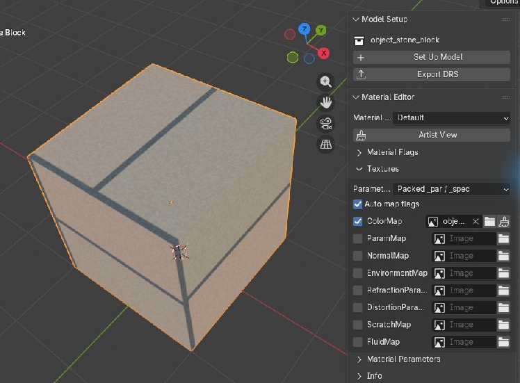

# Artist Model Pipeline

Choose a guide for your model, then export and check a copy in the Map Editor.
Save your editable work as a `.blend` and use a separate export folder.

## Choose your model

| You are making | Follow |
|---|---|
| A static or animated prop | [Object Guide](object_creation_guide.md) |
| A rigged unit | [Unit Guide](unit_creation_buide.md) |
| A building with damage states | [Building Guide](building_creation_guide.md) |

Each guide covers editing an imported model and starting a new one. You do not
need a separate Blender startup scene or an old material library. Use
**Set Up Model** for a new DRS model or **Set Up Building** for a new BMG.

## Model and material

1. Prepare your meshes and UVs.
2. Select a mesh and open **DRS Editor → Material Editor**.
3. Create its DRS material, choose the material type and assign textures.
4. Add collision shapes if your model needs them.
5. Run **Model Setup → Check Model** and fix its errors.

Use the [Default Material Guide](material_artist_workflow.md) for texture
painting, cutouts, flow, wind and reflections. Use the
[Shading Recipes](advanced_shading_guide.md) for smooth transparency and refraction.

For a whole-model preview, click **DRS Editor → Render Setup → Add Render**.
It adds lights, a camera and ground in your current scene. Switch to
**Rendered** shading; press **Space** for animated flow and wind.
Keep **Environment: Forge** for the installed Forge's lighting and paving.
**Forge Props** adds an optional crystal; **Update Render** applies setup changes.

## Animate and attach effects

Skip this section for static models without effects.

| Task | Where to do it |
|---|---|
| Assign Idle, movement and attack Actions | [Animation Set Editor](advanced_abilities_guide.md) |
| Set clip duration, FPS and looping | Animation Set Editor → Clip Settings → Edit Settings |
| Set a release or spawn moment | Animation Set Editor → Edit Markers |
| Place a health bar, projectile point or persistent effect | [Locator Editor](advanced_locators_guide.md) |
| Schedule a sound or effect during an animation | [Effect Set Editor](advanced_effects_guide.md) |
| Create damaged states and preview destruction | [Building Editor](building_creation_guide.md) |

For worked examples, use the [Advanced Animation](animation_advanced_tutorial.md),
[Advanced Effects](effects_advanced_tutorial.md) and [Advanced IK](ik_advanced_tutorial.md)
tutorials. They cover phase clips, hit timing, sound/FX layers and procedural limits.

Click **Save** after editing AnimationSet or EffectSet. After moving a locator,
click **Save Placement**. Save the `.blend` too.

Animation and effect drafts stay with their model while you switch models in this session.
Save each edited model's settings before exporting or saving the `.blend`.
**Check Model** reviews those saved settings, including animation chances and
effect events; it keeps intentional FX silence unchanged.

To resize a DRS model, use **Model Setup → Model Size**. For a complete building,
use **Building Editor → Grid & Helpers → Building Size**. These controls include
the model's animations and attachments; external effects retain their own size.

## Export and check

1. Save your editor changes and `.blend`.
2. For DRS, use **File → Export → BattleForge Model (.drs)** and choose the correct model type.
   Include referenced SKA Actions when exporting animations.
3. For BMG, use **File → Export → BattleForge Building (.bmg)**.
   Keep **External Resources → Local + Custom** to include modules, debris,
   destruction XML and your custom global resources.
4. Fix errors listed in **Export Check**. Expand its review items when needed.
   Save pending Animation Set and Effect Set edits; restore missing included clips.
5. Reimport the exported copy into a new scene and inspect it.
6. Check the final model, animations, collision and effects in the Map Editor.

For models with animations, play the whole clip and check its loop. For buildings,
check every state. Keep packaged custom effects and sounds with their dependencies;
unchanged global game assets remain references. See
[Modules, Debris & Resources](external_resources_guide.md) for editing and installation.

??? tip "Standalone BMS state resources"
    Open **BMG Editor → BMS Editor** to create or edit a standalone BMS.
    A BMS references state models and effects; it does not contain their geometry.

    Set **Resource directory**, use **Check State Resources**, then export a BMS
    copy. Export edited DRS state models separately and keep the referenced
    effects available. Use the Building Guide for the complete BMG workflow.

??? info "Advanced data and preview limits"
    Use **Artist View** for normal authoring. **Debug View** exposes imported
    technical fields when a specific repair needs them.

    **Advanced SKA Data** contains text events and target IDs whose authoring
    workflow is not fully established. Keep imported values unless deliberately
    testing them. Blender does not execute those game events.

    Bake control-rig, constraint and NLA motion onto deform bones before export.
    Check the exported SKA by importing it again.

    The individual guides explain preview limits and where to use the external
    Effect Editor or Map Editor. Final gameplay and engine-dependent shading
    still need the game tools.
