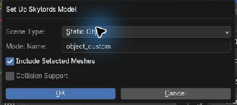
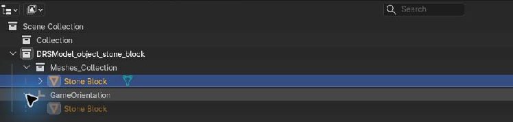
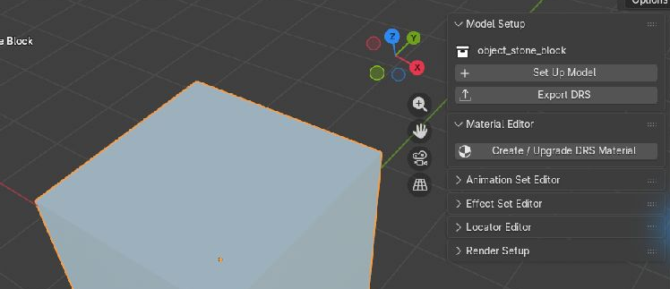
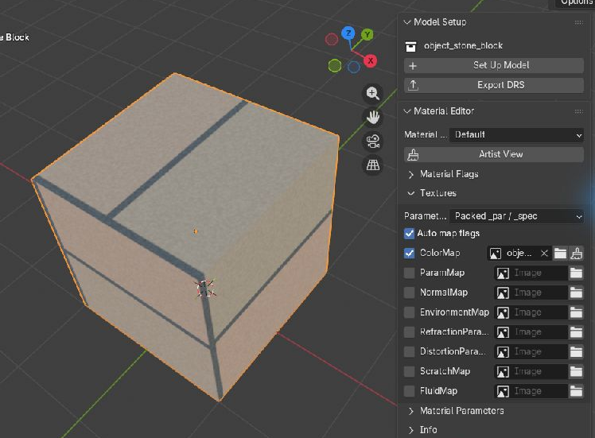
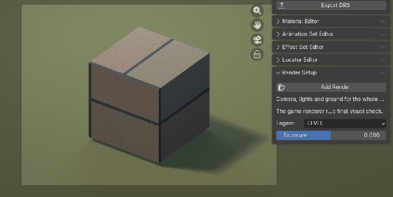
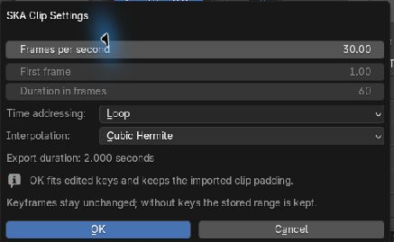
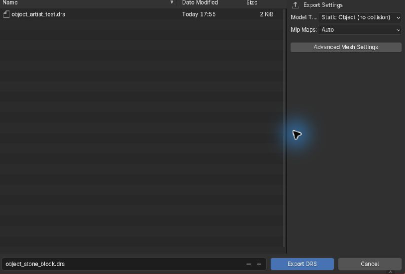

# Object Guide: from Blender to DRS

Create and export **static or animated props**, such as rocks, gates and moving machinery.

## 1. Choose your starting point

### A. Edit an existing DRS

1. Put the `.drs`, its textures and any referenced `.ska` clips in the same folder.
2. Choose **File → Import → Battleforge Model (.drs/.bmg)** and open the `.drs`.
3. Select the visible model mesh and make your changes.

Continue at [step 3](#3-check-your-model). Skip Set Up Model.

### B. Make a model from scratch

Create your model in Blender. Select its meshes, then follow step 2.

### C. Use a model from another program

Import the model with Blender. Select its meshes, then follow step 2.

??? tip "Using a rigged model as a static object"
    Duplicate the meshes and convert the copies to meshes in the desired pose.
    Continue with these copies.

## 2. Set up a new model

Skip this step for an imported DRS.

1. Select your model meshes.
2. Open **DRS Editor → Model Setup → Set Up Model**.
3. Choose **Static Object** or **Animated Object**, enter a name such as `object_stone_block`, and keep
   **Include Selected Meshes** enabled.
4. Enable **Collision Support** if your object needs collision; otherwise leave it off.
   Click **OK**.

!!! info "GameOrientation — your model's parent object"
    **GameOrientation** converts between Blender and game coordinates. Import and
    Set Up Model create it for you.

    - Move, rotate and resize your **meshes**. Leave GameOrientation unchanged.
    - Keep visible meshes in **Meshes_Collection**. For a static object, parent them to GameOrientation.
    - For an animated object, parent the deform armature to GameOrientation and keep skinned meshes attached to their armature.
    - Moving a mesh into the collection does not parent it.
    - Parenting without preserving transforms can rotate or mirror a mesh.
      Use **Object (Keep Transform)** to keep its current placement.

??? tip "Advanced: add another mesh"
    Move the new mesh into this model's **Meshes_Collection** and parent it to
    **GameOrientation** using **Object (Keep Transform)**.

    Use the GameOrientation from the same model. Keep existing rigged meshes
    attached to their armature.

## 3. Check your model

- Use UV-mapped meshes with geometry modifiers applied. For animation, keep the **Armature** modifier.
- Use one DRS material per mesh. Separate multi-material meshes by material.
- Check size and facing against an imported game object if you have one available.

Already imported a DRS and only changed its shape? Keep its existing material and go to step 6.

??? tip "Advanced: large models and export errors"
    - Keep each mesh and the combined model below **32,767 exported vertices**.
      Leave room for extra vertices at UV seams.
    - If you reach the limit, reduce the geometry or export smaller, separate DRS objects.
    - Apply geometry modifiers on a copy before exporting. Keep the editable original.
    - If export fails, read the add-on log and fix the reported object first.

## 4. Create a DRS material

Select a mesh and open **DRS Editor → Material Editor**.
Click **Create DRS Material**, or **Create / Upgrade DRS Material** for a mesh that already has a material.
Choose **Default** as the material type and keep **Artist View**.

## 5. Load your textures

1. Open **Textures**.
2. Click the **folder icon** beside **ColorMap** and choose your PNG or DDS color texture.
3. If you have a normal map, load it into **NormalMap**.
4. Leave **Auto map flags** enabled.

For an imported DRS, keep the assigned textures or replace the ones you want to change.
For a foreign model, load its textures here.

Check the result in **Material Preview**.
For a lit preview, use **DRS Editor → Render Setup → Add Render**.

For cut-out leaves or fences, enable **EnableAlphaTest** under **Material Flags**.
See the [Default Material Guide](material_artist_workflow.md) for more material options.

## 6. Add collision shapes

Skip this step if your object does not need collision.

1. Add cubes, spheres or cylinders and fit them around your model. Use several shapes if needed.
2. Move cubes into **Boxes_Collection**, spheres into **Spheres_Collection**,
   and cylinders into **Cylinders_Collection** under this model's **CollisionShapes_Collection**.
3. Parent the shapes to **GameOrientation** using **Object (Keep Transform)**.
4. Set them to **Wire** display and disable rendering for these helper objects.

Keep boxes rectangular, spheres round and cylinders circular. Avoid bevels and shear.

## 7. Animate your object

For a static object, continue to [export](#8-export).

### Prepare the rig

For an imported animated DRS, keep its existing rig. For a new rig:

1. Put the deform armature in **Armature_Collection**, directly under your **DRSModel_…** collection.
   Create that collection if it is missing.
2. Before weighting or animating, parent the new armature to **GameOrientation** using
   **Object (Without Inverse)**. Set its local location and rotation to **0**, and scale to **1**.
3. Rig and weight your meshes. Keep them in **Meshes_Collection**, parented to the
   armature using **Object (Keep Transform)**.
4. Check that each mesh's **Armature** modifier points to that rig. Use no more than
   **four bone weights per vertex**. Run **Animation Set Editor → Skinning → Check Skin Weights**.

### Assign the Idle animation

1. Create your repeating motion as an Action on the deform armature.
2. Select a model mesh and open **DRS Editor → Animation Set Editor**.
3. Click **Initialize Animation Set** (or **Init**), choose **Animated Object**,
   leave **Replace Existing Mappings** off and confirm.
4. Select **Idle** in **Base** mode and assign your Action to its variant, or keep the imported Action.
5. Open **Clip Settings → Edit Settings**. Set the clip timing and **Time addressing → Loop**, then confirm with **OK**.
6. Use **Play** to check the loop, then click **Save** in Animation Set Editor.

Animated objects automatically play **Base Idle**. Other action types are greyed out.

??? tip "Advanced: rig controls and IK"
    Bake the evaluated motion onto the deform bones of an export copy.
    Export keyed bone location and quaternion rotation. Keep the original control rig.
    Check the exported SKA after reimport.

??? tip "Advanced: a rig from another program"
    Use a compatible imported DRS rig or prepare a new rig as above. Transfer the
    mesh and retarget the animation to that deform rig. Bake control-rig motion
    onto the deform bones of an export copy, then check a DRS/SKA reimport.
    Keep your original foreign rig intact.

??? tip "Advanced: play another animation from a map script"
    **Gate setup:**

    - **Decorative gate:** keep the frame and door in one model.
    - **Gate that opens a passage:** export the frame and door as separate models,
      each with its own collision shape. Place them separately in the map.

    To control the door:

    1. Create the opening motion as a separate Action.
    2. Export it with **File → Export → Battleforge Animation (.ska)**.
    3. Give the SKA filename to the map author. Their script plays it on the door
       and switches the door's blocking when opening or closing the passage.

    Keep Idle in AnimationSet. Do not add an Attack or Walk mapping for this clip.

## 8. Export

1. Select a mesh belonging to the model.
2. Open **DRS Editor → Model Setup → Export DRS**.
3. Choose a separate output folder and a filename such as `object_stone_block.drs`.
4. Choose the matching **Model Type**:

    | Object | Without collision | With collision |
    | --- | --- | --- |
    | Static | Static Object (no collision) | Static Object (with collision) |
    | Animated | Animated Object (no collision) | Animated Object (with collision) |

5. For an animated object, enable **Export All SKA Actions** to include the clips
   assigned in your saved AnimationSet. Keep **No Prefix** unless you need a different naming scheme.
6. Keep **Mip Maps → Auto** and the other defaults. Click **Export DRS**.

??? tip "Advanced: export options"
    For extra mesh controls, open **Advanced Mesh Settings** in the export window.

    | Option | Setting |
    | --- | --- |
    | Split Mesh by UV Islands | Keep enabled unless you have prepared the splits yourself. |
    | Flip Normals | Use only to correct confirmed inside-out faces. |
    | Auto-fix Quad Faces | Keep enabled to export quads as triangles. |
    | Mip Maps | Keep **Auto**. Change only to limit the exported mip levels. |
    | Keep Debug Collection | Enable to inspect the prepared export copy. |

## 9. Check the exported copy

1. Keep the exported `.drs`, `.dds` textures and any `.ska` clips together in the output folder.
2. Import the DRS into a fresh Blender scene. Enable **Import Collision Shape** if used.
   Check orientation, size, textures and collision fit. For an animated object,
   also enable **Import Animation** and check the full Idle loop.
3. Test it in the Skylords Map Editor.

If a texture is missing, check its slot in Material Editor and the export folder.
