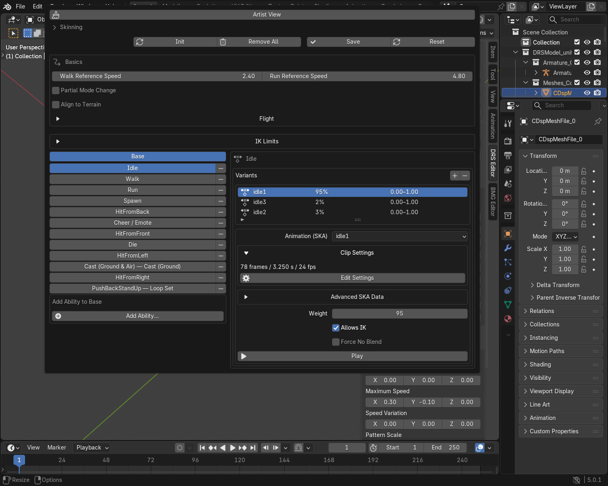
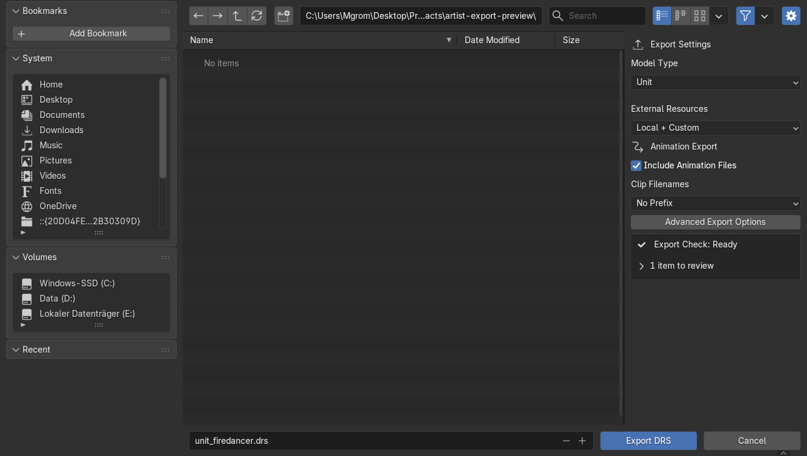

# Unit Guide

For detailed animation, effect and IK workflows, use the
[Advanced Animation](animation_advanced_tutorial.md),
[Advanced Effects](effects_advanced_tutorial.md) and
[Advanced IK](ik_advanced_tutorial.md) tutorials.

Create or edit a rigged unit and export its model, textures and animations.
For props, use the [Object Guide](object_creation_guide.md). For buildings with
damage states, use the [Building Guide](building_creation_guide.md).

## 1. Choose your starting point

=== "Existing unit"
    1. Use **File → Import → Battleforge Model (.drs/.bmg)** and choose the unit's `.drs`.
    2. Enable **Animation Clips** to load the clips used by this unit.
    3. Select one of the unit's meshes and make your changes.

    Keep the imported rig and GameOrientation. Save a working `.blend` before editing.
    Disable **Clear Existing Content** to keep existing models and Actions, including those in other scenes.
    **Advanced Import Options → Other Clips in Folder** also loads nearby SKAs
    that this unit does not reference. Leave it off unless you need them.

=== "New unit"
    1. Prepare your meshes and select them.
    2. Open **DRS Editor → Model Setup → Set Up Model** and choose **Unit**.
    3. Create **Armature_Collection** inside this model and put your deform rig
       there. Before weighting, parent it to **GameOrientation** using
       **Object (Without Inverse)**; use local location/rotation `0` and scale `1`.
    4. Bind the meshes to that rig and weight them.

    Starting with a compatible imported skeleton is useful when reusing game animations.

=== "Foreign model"
    1. Import the model using Blender's importer for its format.
    2. Select its meshes and use **Set Up Model → Unit**.
    3. Prepare an export deform rig as described under **New unit**. Keep the
       foreign rig as your source; transfer weights and retarget its animation
       to the prepared rig.
    4. Parent the meshes to the export rig with **Keep Transform** and check
       their Armature modifiers. Bake the motion onto its deform bones.
    5. Create DRS materials for its meshes using the [Material Guide](material_artist_workflow.md).

    Bake control-rig and constraint-driven motion onto the deform bones before export.
    Keep the original file as your editable source.

!!! info "GameOrientation"
    **GameOrientation** converts between Blender and game coordinates. Leave
    this helper unchanged. Parenting a rig or mesh to it can visibly rotate the
    object. Use **Keep Transform** if you want to keep its current placement.
    Keep weighted meshes attached to their armature; do not reparent them all
    directly to GameOrientation.

Use **Model Setup → Model Size** to resize the whole unit. `0.5` halves it;
`2` doubles it. Play its animations afterward. External effect assets keep their
own dimensions.

## 2. Check the mesh and weights

Use the [Object Guide](object_creation_guide.md) for mesh, UV, material and
collision setup. Each skinned mesh needs an Armature modifier targeting the
deform rig, with vertex groups matching its bones.

Open **Animation Set Editor → Skinning → Check Skin Weights**. Fix unweighted
vertices, keep at most **four bone influences per vertex**, and normalize the
weights. The result buttons select affected vertices for editing. Run the check
again after making changes.

Before animating a new rig, set its deform bones to **Quaternion (WXYZ)** rotation.
Animate the deform bones rather than moving the armature object or GameOrientation.
SKA exports bone location and quaternion rotation. Animated bone scale and
Euler-only rotation curves are not exported; use **Model Size** for a uniform
resize of the whole unit. Existing Euler animation needs conversion or rebaking,
not just a rotation-mode switch.

## 3. Assign animations

1. Open **DRS Editor → Animation Set Editor**.
2. For a new unit, click **Init** (or **Initialize Animation Set**), choose **Unit**, then **OK**.
3. Choose **Idle**, select a variant and assign its **Animation (SKA)**.
4. Assign your Walk, Run, Spawn and Die Actions where needed.
5. Open **Clip Settings → Edit Settings** to check duration, FPS and looping.
6. Check each animation with **Play**, then click **Save**.

> Keep a working **Base Idle**. Several missing animations fall back to it.

The starter entries are unassigned. **Add Ability** adds attack, cast or other
mappings used by the unit's existing gameplay setup. It does not create a new
gameplay ability. Imported units can have more entries than a new starter set.

For alternative Idle animations, add variants and use weights such as **80 / 20**.
Check every variant. **Save** stores the mappings; save your `.blend` too.

For attack phases, modes, release timing and IK limits, use the
[Animation Set Guide](advanced_abilities_guide.md).

## 4. Place the unit's locators

Open **DRS Editor → Locator Editor**. Common choices are:

| Locator | Place it at |
|---|---|
| Health Bar | The desired health-bar position above the unit. |
| Figure Hit Offset | The unit's intended hit-reference point. |
| Projectile Spawn | The weapon or hand that releases the projectile. |
| Persistent Figure FX | The attachment used by a continuous effect. |

Match a comparable working unit. Not every unit uses every locator.

Choose the type and **Attach to**, click **Apply Changes**, then move or rotate
the helper and click **Save Placement**. Check bone attachments in several poses.
See the [Locator Guide](advanced_locators_guide.md) for attachments and effect selection.

## 5. Add release markers and effects when needed

For an attack or spawn event, select its animation variant and click
**Edit Markers**. Set **Time** between `0` and `1`: `0.5` is halfway through
the whole clip. Confirm with **OK**, preview with **Display Marker**, then **Save**.

Keep imported marker directions. For ordinary attacker-to-target pushback,
use **Direction 0, 0, 0**. Projectile placement uses its locator.

For sounds or visual effects, use **Effect Set Editor**. Assign the matching
Action, add an event and select a resource. Start with one variant at **100%**.
Click **Save**, then **Update Preview**, and press **Space**.
Follow the [Effect Set Guide](advanced_effects_guide.md) for the full steps.

## 6. Export and check

1. Save changes in Animation Set Editor and Effect Set Editor. Save locator
   placement and your `.blend`.
2. Run **Model Setup → Check Model** and fix its errors.
3. Open **File → Export → BattleForge Model (.drs)** and choose **Unit**.
4. Enable **Include Animation Files** to include the referenced clips.
5. Fix any **Export Check** errors, then export to a separate output folder.
   If an included clip is missing, load it or restore its source file.
6. Reimport the exported copy in a new scene. Check the whole animation and its loop.
7. Test movement, attacks, attachments and effects in the Map Editor.

Keep exported DRS, texture and SKA filenames together. Install custom effects
and sounds separately; the DRS stores their references.

??? tip "Advanced: animation export"
    Bake IK, constraints and NLA results onto the **deform rig** before exporting.
    Do not export the control rig as the game skeleton. Check the exported SKA
    by importing it again, especially after changing the rest pose or retiming.

    For cubic animation, prefer aligned curve handles and check the motion
    between keys after reimport. Blender's independent incoming and outgoing
    handles cannot both be stored as one SKA tangent.

    **Include Animation Files** includes saved AnimationSet, marker and EffectSet
    references. It does not export every unrelated Action in your `.blend`.
    Check the filename-prefix options rather than renaming exported SKAs by hand.

??? info "If something looks wrong"
    | Problem | Check |
    |---|---|
    | The rig plays correctly but export does not | Bake the deform Action and reimport the exported SKA. |
    | An attachment returns to its old position | Click Save Placement in Locator Editor. |
    | An Action is missing from export | Assign it in the intended editor and Save before exporting. |
    | Movement slides along the ground | Check the clip's Walk / Run Reference Speed against its authored motion. |
    | The whole animation faces the wrong way | Check the rig's parent and rest pose before changing GameOrientation. |
